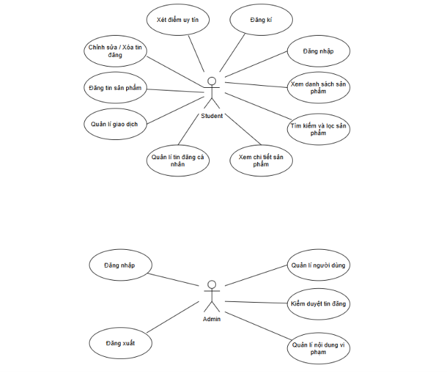

# USE CASE DIAGRAM - UNIEXCHANGE

## 1. Tổng quan

Biểu đồ Use Case mô tả các chức năng chính của hệ thống UniExchange và mối quan hệ tương tác giữa các tác nhân với hệ thống.

UniExchange là hệ thống hỗ trợ sinh viên trao đổi giáo trình, tài liệu học tập và các thiết bị học tập đã qua sử dụng trong môi trường trường học.

Biểu đồ tập trung thể hiện hai nhóm tác nhân chính là Student (Sinh viên) và Admin (Quản trị viên), cùng các chức năng tương ứng mà mỗi tác nhân có thể thực hiện.

## 2. Biểu đồ Use Case

## 3. Mô tả các tác nhân (Actors)

### 3.1. Student (Sinh viên)

Sinh viên là người sử dụng chính của hệ thống UniExchange. Tác nhân này có thể đăng ký tài khoản, đăng nhập, tìm kiếm và xem thông tin sản phẩm, đăng tin sản phẩm, quản lý tin đăng cá nhân, quản lý giao dịch và theo dõi điểm uy tín.

### 3.2. Admin (Quản trị viên)

Quản trị viên chịu trách nhiệm quản lý và giám sát hoạt động của hệ thống. Tác nhân này có thể đăng nhập, đăng xuất, quản lý người dùng, kiểm duyệt tin đăng và xử lý các nội dung vi phạm.

## 4. Mô tả các Use Case

### 4.1. Nhóm chức năng Student (Sinh viên)

| STT | Use Case | Mô tả |
|---|---|---|
| 1 | Đăng ký | Cho phép sinh viên tạo tài khoản mới để sử dụng hệ thống. |
| 2 | Đăng nhập | Cho phép sinh viên xác thực tài khoản và truy cập hệ thống. |
| 3 | Xem danh sách sản phẩm | Hiển thị danh sách các sản phẩm được đăng tải trên hệ thống. |
| 4 | Tìm kiếm và lọc sản phẩm | Hỗ trợ tìm kiếm sản phẩm theo từ khóa và các tiêu chí lọc. |
| 5 | Xem chi tiết sản phẩm | Cho phép xem thông tin chi tiết của sản phẩm được đăng tải. |
| 6 | Quản lý tin đăng cá nhân | Cho phép sinh viên theo dõi và quản lý các tin đăng do mình tạo. |
| 7 | Quản lý giao dịch | Cho phép sinh viên theo dõi và quản lý các giao dịch trao đổi sản phẩm. |
| 8 | Đăng tin sản phẩm | Cho phép sinh viên đăng tải thông tin sản phẩm cần trao đổi. |
| 9 | Chỉnh sửa / Xóa tin đăng | Cho phép sinh viên cập nhật thông tin hoặc xóa tin đăng của mình. |
| 10 | Xem điểm uy tín | Cho phép sinh viên theo dõi điểm uy tín của tài khoản. |

### 4.2. Nhóm chức năng Admin (Quản trị viên)

| STT | Use Case | Mô tả |
|---|---|---|
| 1 | Đăng nhập | Cho phép quản trị viên xác thực tài khoản có quyền quản trị. |
| 2 | Đăng xuất | Cho phép quản trị viên kết thúc phiên làm việc. |
| 3 | Quản lý người dùng | Cho phép quản trị viên theo dõi và quản lý thông tin, trạng thái tài khoản. |
| 4 | Kiểm duyệt tin đăng | Cho phép quản trị viên kiểm tra nội dung tin đăng. |
| 5 | Quản lý nội dung vi phạm | Cho phép quản trị viên xem xét và xử lý các nội dung vi phạm quy định. |

## 5. Tệp biểu đồ và chỉnh sửa

- **Ảnh biểu đồ:** Được lưu trong thư mục này dưới định dạng PNG để xem trực tiếp.
- **Chỉnh sửa biểu đồ:** Sử dụng đường link Google Drive bên dưới để mở bản biểu đồ có thể chỉnh sửa.

[Truy cập biểu đồ Use Case để chỉnh sửa](https://drive.google.com/file/d/1tbId447-SfO0D4YTlvkYsmjDIbZ-sGCJ/view?usp=sharing)

## 6. Kết luận

Biểu đồ Use Case cung cấp cái nhìn tổng quan về các chức năng của hệ thống UniExchange và cách hai nhóm tác nhân Student và Admin tương tác với hệ thống.

Việc xác định các tác nhân và chức năng giúp làm rõ phạm vi hoạt động của hệ thống, đồng thời là cơ sở cho quá trình phân tích, thiết kế và triển khai các chức năng tiếp theo.