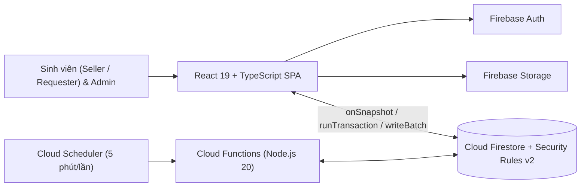

# 🎓 UniExchange — Hệ thống Thư viện & Sàn Trao đổi Giáo trình, Thiết bị Cũ trong Trường học

> **Đồ án Công nghệ Phần mềm** — Ứng dụng Web/Mobile Responsive nội bộ giúp sinh viên trao tặng miễn phí (`0 đồng`) hoặc nhượng lại giáo trình, tài liệu ôn thi và thiết bị học tập cũ an toàn, minh bạch ngay trong khuôn viên trường đại học.

---

## 📌 Mục lục

1. [Tổng quan Dự án & Thành viên (WBS)](#-1-tổng-quan-dự-án--thành-viên-wbs)
2. [Tính năng Nghiệp vụ Chính](#-2-tính-năng-nghiệp-vụ-chính)
3. [Công nghệ Sử dụng (Tech Stack)](#-3-công-nghệ-sử-dụng-tech-stack)
4. [Kiến trúc & Cơ sở Dữ liệu](#-4-kiến-trúc--cơ-sở-dữ-liệu)
5. [Cơ chế Điểm Tín nhiệm (Trust Score)](#-5-cơ-chế-điểm-tín-nhiệm-trust-score)
6. [Cấu trúc Thư mục Dự án](#-6-cấu-trúc-thư-mục-dự-án)
7. [Hướng dẫn Cài đặt, Kiểm tra & Triển khai](#-7-hướng-dẫn-cài-đặt-kiểm-tra--triển-khai)
8. [Bảo mật & Chống Xung đột Đồng thời](#-8-bảo-mật--chống-xung-đột-đồng-thời)
9. [Tài liệu Đặc tả Liên quan](#-9-tài-liệu-đặc-tả-liên-quan)

---

## 🎯 1. Tổng quan Dự án & Thành viên (WBS)

**UniExchange** giải quyết bài toán lãng phí giáo trình, dụng cụ thực hành sau mỗi học kỳ thông qua quy trình trao đổi nội khu có kiểm duyệt nội dung, khóa giữ chỗ nguyên tử `24–48 giờ` và đánh giá Điểm tín nhiệm tự động.

| Ký hiệu | Họ và tên | Vai trò chính (Role) | Hạng mục phụ trách cốt lõi |
| :---: | :--- | :--- | :--- |
| **TV1** | **Thành Đạt** | Project Manager (PM) & Backend Core | Kiến trúc hệ thống, nghiệp vụ giữ chỗ `24–48h` & khóa chống `Race Condition` (`FR-05`, `NFR-01`). |
| **TV2** | **Quốc Dũng** | Database Engineer (DB) & Backend | Thiết kế ERD, chuẩn hóa CSDL & Rules (`NFR-02`), Điểm tín nhiệm (`FR-07`) & `Cronjob` (`FR-06`, `NFR-03`). |
| **TV3** | **Văn Dệ** | Business Analyst (BA) & Backend | Đặc tả SRS, sơ đồ UML, nghiệp vụ Đăng tin (`FR-02`), Kiểm duyệt Admin (`FR-03`) & Tìm kiếm/Lọc (`FR-04`). |
| **TV4** | **Tiến Thắng** | UI/UX Designer & Frontend Lead (FE) | Thiết kế giao diện & lập trình Frontend cho 3 Actors (`Seller`, `Requester`, `Admin`), kiểm thử (`WBS 4.1`). |

---

## ✨ 2. Tính năng Nghiệp vụ Chính

| Mã YC | Nhóm chức năng | Actor | Mô tả tóm tắt |
| :---: | :--- | :---: | :--- |
| **`FR-01`** | Xác thực & Hồ sơ | Sinh viên, Admin | Đăng nhập Email trường / Google / SĐT OTP; khởi tạo hồ sơ `100` điểm uy tín & xem sổ cái `trust_history`. |
| **`FR-02`** | Đăng tin & Quản lý đồ | `Seller / Donor` | Đăng tặng `0đ` (`gift`) hoặc nhượng giá tượng trưng (`sell`) kèm ảnh, mã môn học & độ mới; xóa khi chưa `held`. |
| **`FR-03`** | Kiểm duyệt & Danh mục | `Admin` | Duyệt / từ chối / ẩn bài đăng (ghi vết `moderation_logs`); quản trị `categories`, `subjects`, `meetup_locations`. |
| **`FR-04`** | Tìm kiếm & Bộ lọc `0đ` | `Requester` | Tìm nhanh theo tên sách/mã học phần, lọc danh mục, tình trạng và bộ lọc chuyên biệt **"Tặng miễn phí (0 đồng)"**. |
| **`FR-05`** | Giữ chỗ `24–48h` & Hẹn gặp | `Requester`, `Seller` | Khóa độc quyền vật phẩm trong `24h` hoặc `48h`, chọn điểm hẹn nội khu, giờ gặp (`proposed_time`) và ghi chú. |
| **`FR-06`** | Vòng đời giao dịch | Sinh viên, Hệ thống | Xác nhận giao nhận hoàn tất, chủ động hủy hẹn, hoặc tự động thu hồi khóa giữ chỗ khi quá hạn (`Auto-Release`). |
| **`FR-07`** | Điểm tín nhiệm | Hệ thống, `Admin` | Tự động cộng/trừ điểm theo cam kết lịch hẹn; khóa quyền đặt giữ chỗ nếu điểm `< 50`. |

---

## 🛠️ 3. Công nghệ Sử dụng (Tech Stack)

| Tầng (Layer) | Công nghệ / Thư viện | Mục đích sử dụng |
| :--- | :--- | :--- |
| **Frontend** | `React 19`, `TypeScript`, `Vite 8` | Ứng dụng SPA tốc độ cao, đồng bộ kiểu dữ liệu `snake_case`. |
| **UI & Styling** | `Tailwind CSS v4`, `Motion`, `Lucide React`, `date-fns` | Giao diện Mobile-first Responsive, hiển thị đếm ngược hạn giữ chỗ tiếng Việt. |
| **Auth & Storage** | `Firebase Authentication`, `Firebase Storage` | Xác thực đa phương thức & lưu trữ hình ảnh thực tế của sách/thiết bị. |
| **Database** | `Cloud Firestore` + `Security Rules v2` + `Indexes` | Cơ sở dữ liệu Realtime NoSQL hỗ trợ `runTransaction` & `writeBatch` nguyên tử. |
| **Serverless** | `Cloud Functions for Firebase` (`Node.js 20`) + `Scheduler` | Callable `createHoldOrder` và Cronjob `scheduledHoldAutoRelease` chạy mỗi 5 phút. |

---

## 🏗️ 4. Kiến trúc & Cơ sở Dữ liệu

### 4.1. Luồng Kiến trúc Hệ thống



### 4.2. Schema Cloud Firestore (`8 Root Collections + 3 Subcollections`)

| STT | Đường dẫn Collection / Subcollection | Thực thể & Trường khóa tiêu biểu |
| :-: | :--- | :--- |
| 1 | `/users/{userId}` | Hồ sơ người dùng (`student_id_code`, `role`, `current_trust_score`, `status`, `hold_locked_until`). |
| 2 | `/users/{userId}/trust_history/{logId}` | Sổ cái điểm bất biến (`score_change`, `balance_after`, `event_type`, `reference_id`). |
| 3 | `/categories/{categoryId}` | Danh mục học liệu (`category_name`, `display_order`, `is_active`). |
| 4 | `/subjects/{subjectId}` | Danh mục môn học (`subject_code`, `subject_name`, `faculty`, `is_active`). |
| 5 | `/meetup_locations/{locationId}` | Điểm hẹn an toàn nội khu (`location_name`, `campus`, `landmark_description`). |
| 6 | `/items/{itemId}` | Bài đăng vật phẩm (`seller_id`, `item_type`, `price`, `item_status`, `active_hold_id`, `moderation_status`). |
| 7 | `/items/{itemId}/moderation_logs/{modLogId}` | Nhật ký kiểm duyệt của Admin (`admin_id`, `action`, `reason`). |
| 8 | `/holds/{holdId}` | Phiên giữ chỗ `24–48h` (`item_id`, `requester_id`, `hold_expires_at`, `hold_status`). |
| 9 | `/meetups/{meetupId}` | Thỏa thuận lịch hẹn (`hold_id`, `location_name`, `proposed_time`, `status`). |
| 10 | `/transactions/{txId}` | Biên bản giao dịch (`hold_id`, `final_amount`, `payment_method`, `current_status`). |
| 11 | `/transactions/{txId}/status_logs/{logId}` | Nhật ký trạng thái giao dịch bất biến (`from_status`, `to_status`, `changed_by`). |

---

## ⭐ 5. Cơ chế Điểm Tín nhiệm (`Trust Score`)

| Mã sự kiện | Sự kiện nghiệp vụ | Biến động | Hệ quả trên hệ thống |
| :---: | :--- | :---: | :--- |
| `INIT` | Đăng ký tài khoản sinh viên mới | **`100` (Gốc)** | Mở đầy đủ quyền đăng bài và đặt giữ chỗ. |
| `COMPLETE_TX` | Hoàn tất giao nhận vật phẩm đúng hẹn | **`+5`** | Cộng điểm uy tín (tối đa `200`) và xóa khóa giữ chỗ nếu có. |
| `CANCEL_HOLD` / `EXPIRED_HOLD` | Người nhận tự hủy hoặc để quá hạn `24–48h` | **`-10`** | Tự động trả vật phẩm về `available` và ghi sổ cái `trust_history`. |
| `NO_SHOW` | Bùng hẹn không thông báo | **`-30`** | Admin xác nhận vi phạm và trừ điểm trực tiếp. |
| `ADMIN_ADJUST` | Giải quyết khiếu nại chính đáng | *Tùy chỉnh* | Admin điều chỉnh điểm kèm lý do minh bạch. |
| **`< 50 điểm`** | Chạm ngưỡng cảnh báo vi phạm | **Khóa `Hold`** | Tạm khóa quyền đặt giữ chỗ `7 ngày` (kiểm tra ở cả Client, Functions & `firestore.rules`). |

---

## 📂 6. Cấu trúc Thư mục Dự án

```text
uniexchange/
├── src/
│   ├── components/
│   │   ├── Layout.tsx             # Khung giao diện, điều hướng & hiển thị Trust Score Realtime
│   │   ├── LoginModal.tsx         # Đăng nhập / Đăng ký (Email sinh viên, Google, SĐT OTP)
│   │   ├── ProfileModal.tsx       # Cập nhật hồ sơ cá nhân & xem sổ cái lịch sử trust_history
│   │   ├── Marketplace.tsx        # Sàn trao đổi, tìm kiếm từ khóa, lọc môn học & lọc đồ 0đ
│   │   ├── PostItem.tsx           # Đăng tin chia sẻ học liệu + tải ảnh lên Firebase Storage
│   │   ├── ItemDetail.tsx         # Chi tiết vật phẩm & đặt giữ chỗ nguyên tử 24–48h
│   │   ├── MyHolds.tsx            # Quản lý phiên giữ chỗ, lịch hẹn & xác nhận giao nhận / hủy
│   │   ├── MyItems.tsx            # Quản lý bài đăng cá nhân, trạng thái duyệt & xóa bài
│   │   └── AdminDashboard.tsx     # Quản trị viên: duyệt bài, quản lý môn học/điểm hẹn & Trust Score
│   ├── lib/
│   │   ├── firebase.ts            # Khởi tạo Firebase App, Auth, Firestore & Storage
│   │   ├── FirebaseProvider.tsx   # AuthContext đồng bộ hồ sơ sinh viên & khởi tạo 100đ gốc
│   │   ├── exchangeService.ts     # Nghiệp vụ runTransaction / writeBatch (Hold, Complete, Cancel, Admin)
│   │   └── utils.ts               # Hàm tiện ích UI & chuẩn hóa chẩn đoán lỗi Firestore
│   ├── types/
│   │   └── schema.ts              # TypeScript Interfaces, dữ liệu mẫu & hàm chuẩn hóa dữ liệu
│   ├── App.tsx                    # Điều hướng các phân hệ chính
│   ├── main.tsx                   # Điểm khởi chạy React 19
│   └── index.css                  # Cấu hình Tailwind CSS v4
├── functions/
│   ├── src/index.ts               # Cloud Functions: createHoldOrder & Cronjob scheduledHoldAutoRelease
│   ├── package.json               # Dependencies cho Firebase Functions (Node.js 20)
│   └── tsconfig.json              # Cấu hình TypeScript cho Backend Serverless
├── firebase.json                  # Cấu hình triển khai Firebase CLI (Firestore, Storage, Indexes & Functions)
├── .firebaserc                    # Khai báo Firebase / GCP Project ID mặc định
├── firestore.rules                # Quy tắc bảo mật Firestore v2 (Default Deny + Domain Validators)
├── storage.rules                  # Quy tắc bảo mật Firebase Storage (giới hạn ảnh < 5MB theo UID)
├── firestore.indexes.json         # 10 Composite Indexes tối ưu truy vấn sàn & quét Hold quá hạn
├── scripts/
│   └── verify-race-condition.ts   # Kiểm thử tự động chống Race Condition & ràng buộc FR-05/FR-06 (WBS 4.2)
├── firebase-applet-config.json    # Thông số kết nối Firebase Project cho Frontend
├── firebase-blueprint.json        # Đặc tả JSON Schema cho toàn bộ thực thể Firestore
├── SRS_UniExchange.md             # Tài liệu Đặc tả Yêu cầu Phần mềm (IEEE 830 / ISO 29148)
├── Dac_Ta_CSDL.docx               # Tài liệu Đặc tả Cơ sở dữ liệu
├── erd_system.drawio              # Sơ đồ Thực thể Kết hợp (ERD)
├── security_spec.md               # Đặc tả bất biến dữ liệu & 12 kịch bản kiểm thử bảo mật
└── package.json                   # Scripts và dependencies của Frontend
```

---

## 🚀 7. Hướng dẫn Cài đặt, Kiểm tra & Triển khai

### 7.1. Yêu cầu môi trường
- **Node.js** `>= 20.x`, **npm** và `firebase-tools` (`npm install -g firebase-tools` nếu triển khai lên Firebase/GCP).
- Dự án Firebase đã kích hoạt **Authentication**, **Cloud Firestore** và **Firebase Storage**.

### 7.2. Chạy ứng dụng tại máy cá nhân (Local Development)

```bash
# 1. Cài đặt dependencies cho Frontend
npm install

# 2. (Tùy chọn) Tạo .env.local từ .env.example nếu cấu hình thêm biến môi trường
cp .env.example .env.local

# 3. Khởi chạy máy chủ phát triển tại http://localhost:3000
npm run dev

# 4. Kiểm tra kiểu dữ liệu TypeScript, kiểm thử Race Condition & đóng gói bản dựng Production
npm run lint
npm run test:race
npm run build
```

### 7.3. Kiểm tra (Dry-Run) & Triển khai Backend lên Firebase / Google Cloud

```bash
# 1. Đăng nhập và chọn đúng Firebase / GCP Project (mặc định đọc từ .firebaserc)
firebase login
firebase use default

# 2. Cài đặt & biên dịch kiểm tra mã nguồn Cloud Functions
npm --prefix functions install
npm --prefix functions run build

# 3. Kiểm tra cú pháp & tính hợp lệ của Firestore Security Rules trước khi áp dụng (Preview/Dry-run)
firebase deploy --only firestore:rules --dry-run

# 4. Triển khai chính thức Rules, Storage Rules, Composite Indexes và Cloud Functions
firebase deploy --only firestore:rules,firestore:indexes,storage,functions
```

> **💡 Quyền Quản trị viên (`Admin`):** Hệ thống nhận diện `Admin` qua Custom Claim `role == 'admin'`, trường `users/{uid}.role == 'admin'` trên Firestore, hoặc email quản trị khởi tạo `viducthanhdat3@gmail.com`.

---

## 🔐 8. Bảo mật & Chống Xung đột Đồng thời

- **Chống `Race Condition` khi giữ chỗ (`NFR-01`):** Mọi thao tác đặt giữ chỗ đều thực thi nguyên tử trong `runTransaction`, khóa `active_hold_id` và đối chiếu trạng thái trước/sau bằng `get()` + `getAfter()` ngay tại tầng `firestore.rules`, đảm bảo cùng một thời điểm chỉ duy nhất **01 sinh viên** giữ chỗ thành công.
- **Sổ cái bất biến (`Append-only Ledger` — `NFR-02`):** Các subcollection `trust_history`, `moderation_logs` và `status_logs` đều khóa cứng `allow update, delete: if false;`.
- **Phòng thủ 12 kịch bản *The Dirty Dozen*:** Tệp [`firestore.rules`](./firestore.rules) xác thực nghiêm ngặt kiểu dữ liệu, giới hạn kích thước chuỗi/mảng và chặn toàn bộ 12 payload tấn công mô tả chi tiết trong [`security_spec.md`](./security_spec.md) (*Identity Spoofing, Role Escalation, Item Hijacking, Status Shortcutting, Ghost Item Creation, Price Poisoning, Reservation Overwrite, Time Travel, Large Payload DoS, Orphan Hold, Self-Reservation, Double Holding*).

---

## 📄 9. Tài liệu Đặc tả Liên quan

- 📘 **[SRS_UniExchange.md](./SRS_UniExchange.md):** Đặc tả yêu cầu phần mềm chi tiết (`FR-01` → `FR-07`, `NFR-01` → `NFR-03`, sơ đồ trình tự & ma trận truy vết WBS).
- 🛡️ **[security_spec.md](./security_spec.md) & [firestore.rules](./firestore.rules):** Đặc tả bất biến bảo mật và mã nguồn quy tắc phân quyền Cloud Firestore v2.
- 🗂️ **[firebase-blueprint.json](./firebase-blueprint.json) & [firestore.indexes.json](./firestore.indexes.json):** Cấu trúc thực thể JSON Schema và bộ chỉ mục kết hợp Cloud Firestore.
- 🗄️ **Dac_Ta_CSDL.docx & erd_system.drawio:** Tài liệu đặc tả CSDL và sơ đồ ERD.
