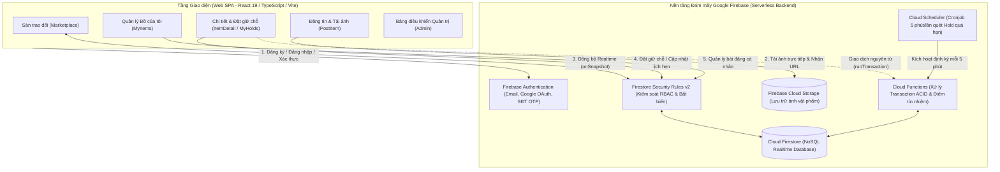
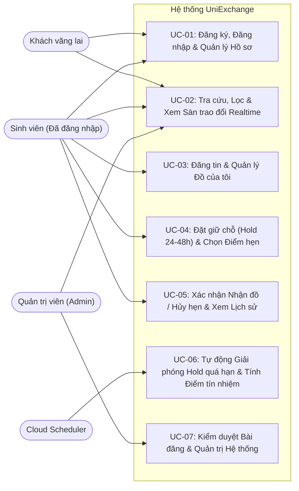
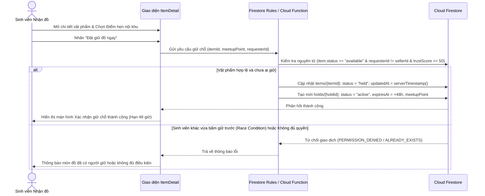
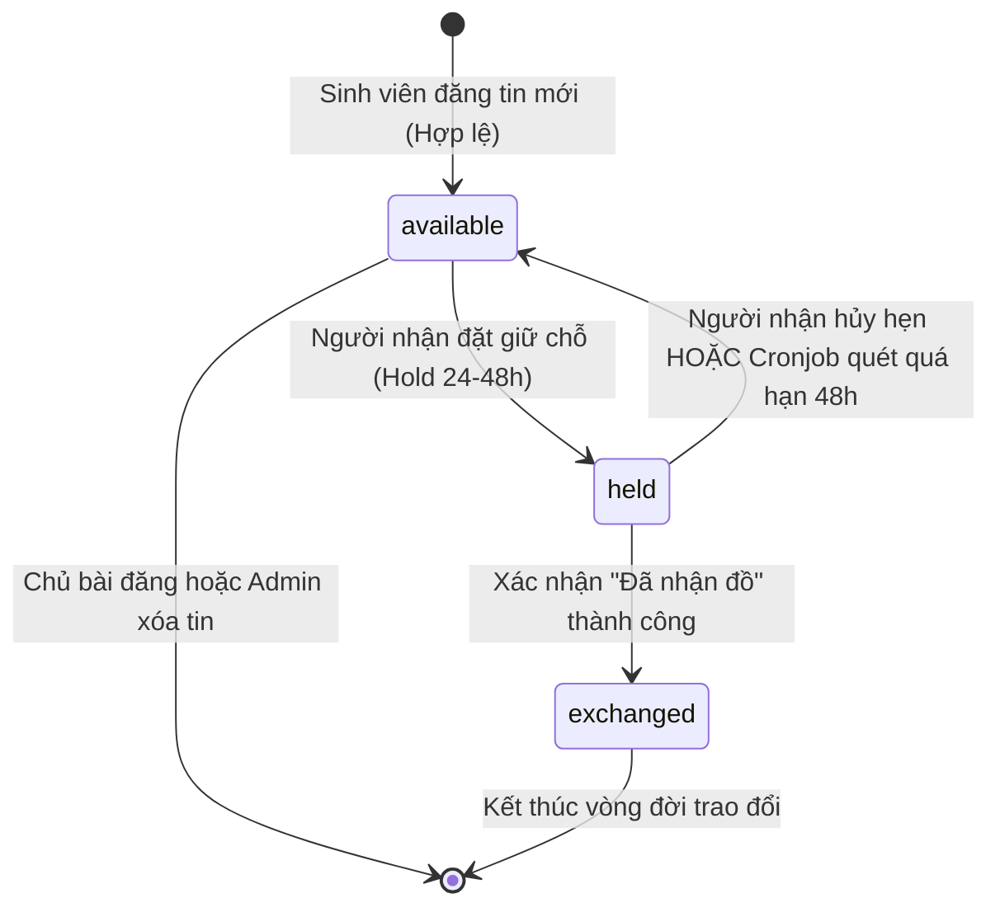
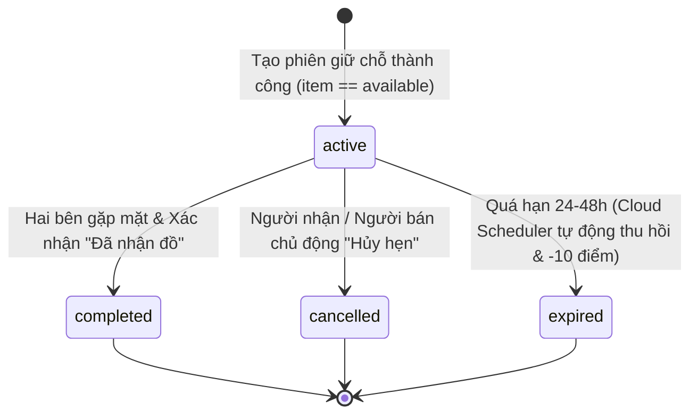
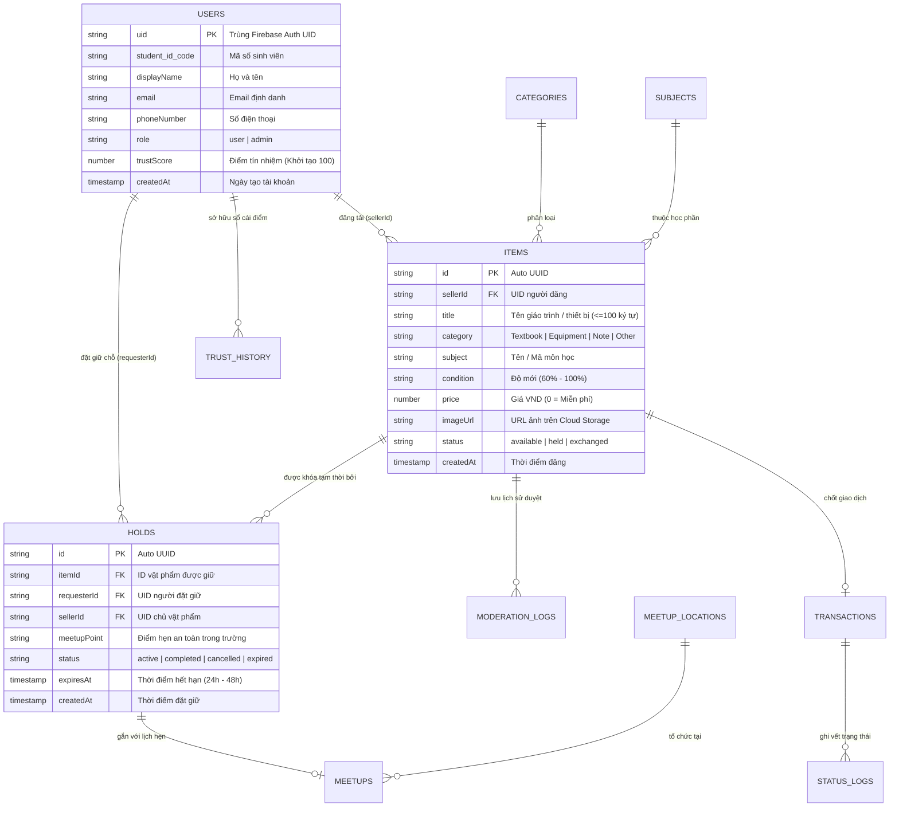

# ĐẶC TẢ YÊU CẦU PHẦN MỀM (SOFTWARE REQUIREMENTS SPECIFICATION - SRS)

**Đề tài:** HỆ THỐNG THƯ VIỆN MỞ / SÀN TRAO ĐỔI GIÁO TRÌNH & THIẾT BỊ CŨ TRONG TRƯỜNG HỌC (**UniExchange**)  
**Phiên bản:** 1.0  
**Tiêu chuẩn áp dụng:** IEEE Std 830-1998 / ISO/IEC/IEEE 29148:2018  
**Ngày lập:** 14/11/2026  

---

## MỤC LỤC

1. [Giới thiệu (Introduction)](#1-giới-thiệu-introduction)
2. [Mô tả tổng quan (Overall Description)](#2-mô-tả-tổng-quan-overall-description)
3. [Đặc tả Yêu cầu Chức năng (Functional Requirements)](#3-đặc-tả-yêu-cầu-chức-năng-functional-requirements)
4. [Yêu cầu Giao diện Ngoài (External Interface Requirements)](#4-yêu-cầu-giao-diện-ngoài-external-interface-requirements)
5. [Yêu cầu Phi chức năng (Non-Functional Requirements)](#5-yêu-cầu-phi-chức-năng-non-functional-requirements)
6. [Mô hình Dữ liệu Logic & Ma trận Truy vết (Data Model & Traceability)](#6-mô-hình-dữ-liệu-logic--ma-trận-truy-vết-data-model--traceability)

---

## 1. Giới thiệu (Introduction)

### 1.1. Mục đích tài liệu (Purpose)
Tài liệu Đặc tả Yêu cầu Phần mềm (SRS) này mô tả toàn diện các yêu cầu nghiệp vụ, yêu cầu chức năng, yêu cầu phi chức năng, các ràng buộc thiết kế và quy tắc bảo mật của hệ thống **UniExchange** — *Hệ thống Thư viện Mở / Sàn Trao đổi Giáo trình & Thiết bị Cũ trong Trường học*.

Tài liệu đóng vai trò là cơ sở thống nhất giữa nhóm phát triển, giảng viên hướng dẫn, kiểm thử viên (QA) và người dùng cuối để thiết kế, hiện thực hóa, kiểm thử nghiệm thu và vận hành hệ thống.

### 1.2. Phạm vi sản phẩm (Product Scope)
Mỗi học kỳ kết thúc, một lượng lớn giáo trình đại cương, sách chuyên ngành, tài liệu ghi chép và dụng cụ học tập (máy tính bỏ túi, linh kiện thực hành, dụng cụ vẽ kỹ thuật...) của sinh viên khóa trước không còn sử dụng đến, trong khi sinh viên khóa sau lại tốn nhiều chi phí mua mới. Việc trao đổi tự phát trên mạng xã hội hiện gặp nhiều hạn chế: bài đăng nhanh trôi, khó tìm theo mã môn học, tình trạng "giữ chỗ ảo / bùng hẹn" phổ biến và tiềm ẩn rủi ro mất an toàn khi giao dịch bên ngoài.

**UniExchange** giải quyết trọn vẹn bài toán trên thông qua nền tảng Web thời gian thực dành riêng cho cộng đồng sinh viên trong trường với các giá trị cốt lõi:
- **Chia sẻ & Tiết kiệm:** Hỗ trợ cả hai hình thức **Tặng miễn phí (0 VND)** và **Nhượng lại giá tượng trưng**.
- **Tìm kiếm chuẩn học thuật:** Phân loại trực quan theo danh mục (`Giáo trình`, `Thiết bị`, `Tài liệu`, `Khác`) và tra cứu tức thời theo môn học/học phần.
- **Đặt giữ chỗ độc quyền (Hold 24–48h):** Chống tranh chấp đồng thời (Race Condition) khi nhiều sinh viên cùng đặt nhận một món đồ hiếm; tự động thu hồi quyền giữ chỗ nếu quá hạn.
- **Giao dịch nội khu an toàn:** Chuẩn hóa các điểm hẹn công khai ngay trong khuôn viên trường (Thư viện, Sảnh giảng đường, Nhà văn hóa sinh viên, Căn tin trung tâm).
- **Hệ thống Điểm tín nhiệm (Trust Score):** Xây dựng văn hóa trao đổi văn minh, thưởng điểm khi hoàn tất giao dịch và trừ điểm/khóa quyền giữ chỗ đối với hành vi bùng hẹn.

### 1.3. Định nghĩa, Thuật ngữ và Từ viết tắt (Definitions, Acronyms & Abbreviations)

| Thuật ngữ / Từ viết tắt | Giải thích chi tiết |
| :--- | :--- |
| **SRS** | *Software Requirements Specification* — Tài liệu Đặc tả Yêu cầu Phần mềm. |
| **SPA** | *Single Page Application* — Ứng dụng Web trang đơn phản hồi tức thời không cần tải lại trang. |
| **Item (Vật phẩm)** | Giáo trình, sách tham khảo, tài liệu ghi chép hoặc thiết bị học tập được sinh viên đăng lên sàn. |
| **Seller (Người đăng)** | Sinh viên sở hữu vật phẩm, đăng bài chia sẻ miễn phí hoặc nhượng lại trên hệ thống. |
| **Requester / Buyer (Người nhận)** | Sinh viên có nhu cầu nhận tặng hoặc mua lại vật phẩm và thực hiện thao tác đặt giữ chỗ. |
| **Hold (Phiên giữ chỗ)** | Trạng thái khóa tạm thời một vật phẩm trong vòng 24–48 giờ dành riêng cho một Người nhận để hai bên gặp mặt trao đổi. |
| **Meetup Point (Điểm hẹn)** | Địa điểm công cộng nằm trong khuôn viên nhà trường được quy hoạch làm nơi giao nhận vật phẩm an toàn. |
| **Trust Score (Điểm tín nhiệm)** | Chỉ số uy tín của người dùng (khởi tạo `100` điểm, thang chuẩn `0–100+`), phản ánh mức độ cam kết trong các lịch hẹn. |
| **Race Condition** | Tình huống tranh chấp dữ liệu khi hai hay nhiều sinh viên bấm "Đặt giữ đồ" trên cùng một vật phẩm tại cùng một thời điểm. |
| **RBAC** | *Role-Based Access Control* — Cơ chế kiểm soát truy cập dựa trên vai trò (`user`/`student`, `admin`). |

### 1.4. Tài liệu tham chiếu (References)
1. **IEEE Std 830-1998 & ISO/IEC/IEEE 29148:2018:** Tiêu chuẩn quốc tế về Đặc tả Yêu cầu Phần mềm.
2. **Đặc tả Cơ sở dữ liệu:** `Dac_Ta_CSDL.docx` — *Đặc tả Cơ sở dữ liệu Firebase Cloud Firestore hệ thống UniExchange*.
3. **Sơ đồ Thực thể Kết hợp (ERD):** `erd_system.drawio` — *Sơ đồ cấu trúc dữ liệu quan hệ & khóa chống tranh chấp*.
4. **Đặc tả Bảo mật:** `security_spec.md` & `firestore.rules` — *Các bất biến dữ liệu (Data Invariants) và bộ quy tắc phòng chống 12 kịch bản tấn công (The Dirty Dozen)*.

---

## 2. Mô tả tổng quan (Overall Description)

### 2.1. Bối cảnh và Kiến trúc Hệ thống (Product Perspective)
**UniExchange** là một hệ thống độc lập được xây dựng theo kiến trúc **Serverless Realtime Web Application**, kết hợp giao diện người dùng hiện đại bằng **React 19 + TypeScript + Tailwind CSS** với hạ tầng đám mây **Google Firebase**.

### 2.2. Tóm tắt các Chức năng chính (Product Functions)
1. **Định danh & Xác thực đa phương thức:** Hỗ trợ đăng ký/đăng nhập bằng Email & Mật khẩu (ưu tiên email sinh viên `@*.edu.vn`), tài khoản Google (OAuth 2.0) và Số điện thoại qua mã OTP (kèm xác thực reCAPTCHA).
2. **Sàn trao đổi thời gian thực (Realtime Marketplace):** Hiển thị danh sách các vật phẩm đang sẵn sàng (`available`), tự động cập nhật ngay lập tức trên màn hình mọi người dùng khi có bài đăng mới hoặc khi món đồ vừa được giữ chỗ.
3. **Tìm kiếm & Phân loại thông minh:** Tìm kiếm tức thì theo tên sách/thiết bị hoặc tên môn học; bộ lọc nhanh theo 4 nhóm danh mục chuẩn (`Giáo trình`, `Thiết bị`, `Tài liệu`, `Khác`).
4. **Đăng tải & Quản lý vật phẩm:** Cho phép tải ảnh thực tế lên đám mây, khai báo độ mới (`60%` – `100%`), thiết lập giá nhượng lại hoặc tặng miễn phí (`0 VND`), theo dõi trạng thái và xóa tin đăng.
5. **Đặt giữ chỗ tạm thời (Hold 24–48h) & Hẹn gặp nội khu:** Khóa vật phẩm tạm thời để tránh trùng lặp người nhận, chọn điểm hẹn công khai trong trường và theo dõi đồng hồ đếm ngược thời hạn giữ chỗ.
6. **Hoàn tất / Hủy giao dịch & Lịch sử trao đổi:** Đồng bộ trạng thái kép (Batch/Transaction) giữa phiên giữ chỗ (`Hold`) và vật phẩm (`Item`), lưu vết lịch sử giao dịch rõ ràng.
7. **Quản trị Điểm tín nhiệm & Kiểm duyệt (Trust Score & Moderation):** Theo dõi biến động điểm uy tín của sinh viên qua sổ cái bất biến (`trust_history`), tự động thu hồi lượt giữ chỗ quá hạn và hỗ trợ Quản trị viên kiểm duyệt nội dung.

### 2.3. Phân loại Người dùng và Đặc điểm (User Classes & Characteristics)

| Nhóm tác nhân | Vai trò hệ thống | Mô tả đặc điểm & Quyền hạn chính |
| :--- | :--- | :--- |
| **Khách vãng lai (Guest)** | Chưa xác thực (`auth == null`) | Sinh viên truy cập sàn để xem danh sách vật phẩm, tìm kiếm môn học, lọc danh mục và xem chi tiết món đồ. Không được đăng bài hoặc đặt giữ chỗ. |
| **Sinh viên — Người đăng (Seller)** | `role = "user"` / `"student"` (Đã xác thực) | Sinh viên có tài liệu/thiết bị cũ cần chia sẻ. Có quyền đăng tin mới, tải ảnh, cập nhật thông tin, xóa bài đăng (khi chưa bị giữ chỗ) và xác nhận giao dịch. |
| **Sinh viên — Người nhận (Requester / Buyer)** | `role = "user"` / `"student"` (Đã xác thực) | Sinh viên có nhu cầu nhận/mua đồ. Có quyền đặt giữ chỗ vật phẩm của người khác (khi đủ điểm tín nhiệm), chọn điểm hẹn, xác nhận đã nhận đồ hoặc hủy hẹn. |
| **Quản trị viên (Admin)** | `role = "admin"` | Cán bộ thư viện / Đoàn hội / Ban quản trị hệ thống. Có quyền kiểm duyệt bài đăng (`approve`/`reject`/`hide`), quản lý danh mục gốc, tra cứu danh sách người dùng và xử lý khiếu nại điểm tín nhiệm. |
| **Bộ lập lịch Hệ thống (System Scheduler)** | Tác nhân tự động (`Cloud Scheduler`) | Chạy ngầm định kỳ mỗi 5 phút để quét các bản ghi `Hold` quá hạn 24–48h, tự động mở khóa vật phẩm về `available` và trừ điểm tín nhiệm người vi phạm. |

### 2.4. Môi trường Vận hành (Operating Environment)
- **Thiết bị người dùng (Client-side):**
  - Trình duyệt Web hiện đại hỗ trợ ES2022+, WebSockets và Fetch API: Google Chrome (>= 100), Microsoft Edge (>= 100), Mozilla Firefox (>= 100), Safari (>= 15.4).
  - Tương thích đa màn hình (Responsive Web Design): Máy tính để bàn/Laptop (>= 1024px), Máy tính bảng (768px – 1023px) và Điện thoại thông minh (360px – 767px).
- **Hạ tầng máy chủ (Serverless Cloud):**
  - Xác thực: Google Firebase Authentication.
  - Cơ sở dữ liệu: Google Cloud Firestore (chế độ Native Mode, đồng bộ thời gian thực).
  - Lưu trữ tệp tin: Google Firebase Cloud Storage.
  - Xử lý nghiệp vụ nền: Node.js (>= 20.x) trên Firebase Cloud Functions & Cloud Scheduler.

### 2.5. Ràng buộc Thiết kế và Triển khai (Design & Implementation Constraints)
1. **Giới hạn kỹ thuật Cloud Firestore:** Kích thước tối đa 1 MB trên mỗi Document và tốc độ ghi tối đa khoảng 1 lượt ghi/giây trên cùng một Document đơn lẻ. Do đó, các nhật ký biến động liên tục (`trust_history`, `moderation_logs`, `status_logs`) bắt buộc phải tách thành Subcollection thay vì nhúng mảng vô hạn.
2. **Xác thực thời gian máy chủ (Server Timestamp):** Mọi dấu thời gian tạo mới và cập nhật (`createdAt`, `updatedAt`) phải khớp với `request.time` của máy chủ Firebase để ngăn chặn hành vi giả mạo thời gian từ trình duyệt.
3. **Ràng buộc Xác thực Email:** Các thao tác ghi dữ liệu trọng yếu trên Firestore yêu cầu tài khoản đã xác thực (`isVerified()`).
4. **Ngôn ngữ giao diện:** Toàn bộ giao diện hiển thị, thông báo trạng thái và định dạng thời gian tương đối (`date-fns/locale/vi`) sử dụng Tiếng Việt chuẩn, định dạng tiền tệ Việt Nam Đồng (`VND`).

### 2.6. Giả định và Phụ thuộc (Assumptions & Dependencies)
- **Giao dịch trực tiếp tại trường:** Hệ thống đóng vai trò cầu nối thông tin và điều phối lịch giữ chỗ; việc kiểm tra tình trạng vật lý của sách/thiết bị và thanh toán (tiền mặt hoặc chuyển khoản ngân hàng nếu có phí) được hai sinh viên thực hiện trực tiếp tại điểm hẹn nội khu.
- **Phụ thuộc hạ tầng:** Hệ thống phụ thuộc vào tính sẵn sàng của Google Cloud / Firebase SDK và kết nối Internet của sinh viên khi thao tác đặt giữ chỗ.

---

## 3. Đặc tả Yêu cầu Chức năng (Functional Requirements)

### 3.1. Sơ đồ Tổng quan Chức năng theo Tác nhân

---

### 3.2. Phân hệ 1: Xác thực & Quản lý Hồ sơ Người dùng (`UC-01`)

- **Tác nhân:** Khách vãng lai, Sinh viên, Quản trị viên.
- **Mô tả:** Cung cấp cơ chế đăng ký, đăng nhập đa phương thức và tự động khởi tạo hồ sơ định danh sinh viên gắn liền với Điểm tín nhiệm khởi đầu.
- **Tiền điều kiện:** Người dùng mở hộp thoại Đăng nhập (`LoginModal`).
- **Hậu điều kiện:** Phiên đăng nhập được thiết lập, bản ghi `users/{uid}` tồn tại trên Firestore và thông tin cá nhân kèm điểm tín nhiệm hiển thị ở thanh điều hướng bên trái (`Sidebar`).

#### Bảng đặc tả yêu cầu chi tiết:

| Mã YC | Tên yêu cầu | Mô tả chi tiết quy tắc xử lý | Mức ưu tiên |
| :--- | :--- | :--- | :---: |
| **FR-AUTH-01** | Đăng ký bằng Email & Mật khẩu | Cho phép người dùng tạo tài khoản mới với `Họ và tên`, `Email` và `Mật khẩu`. Ngay sau khi tạo Auth thành công, hệ thống khởi tạo Document `users/{uid}` với `role = "user"`, `trustScore = 100` và `createdAt = serverTimestamp()`. | Bắt buộc |
| **FR-AUTH-02** | Đăng nhập bằng Email / Google | Hỗ trợ đăng nhập bằng Email & Mật khẩu hoặc đăng nhập một chạm qua cửa sổ bật lên Google OAuth (`GoogleAuthProvider`). Nếu đăng nhập lần đầu bằng Google, hệ thống tự động đồng bộ `displayName`, `email`, `photoURL` và cấp `trustScore = 100`. | Bắt buộc |
| **FR-AUTH-03** | Đăng nhập bằng Số điện thoại (OTP) | Hỗ trợ nhập số điện thoại định dạng quốc tế (`+84...`), kích hoạt `RecaptchaVerifier` ẩn (`invisible`) để gửi mã SMS OTP 6 chữ số và xác thực phiên đăng nhập. | Cao |
| **FR-AUTH-04** | Quản lý hồ sơ & Bảo vệ trường nhạy cảm | Sinh viên chỉ được phép chỉnh sửa thông tin hiển thị cá nhân (`displayName`, `photoURL`). Nghiêm cấm người dùng tự ý thay đổi `uid`, `role`, `email` hoặc `trustScore` từ phía Client. | Bắt buộc |
| **FR-AUTH-05** | Đăng xuất an toàn | Cho phép người dùng kết thúc phiên làm việc (`signOut`), xóa trạng thái người dùng khỏi bộ nhớ đệm giao diện và chuyển về chế độ Khách vãng lai. | Bắt buộc |

---

### 3.3. Phân hệ 2: Sàn Trao đổi & Tìm kiếm Thời gian thực (`UC-02`)

- **Tác nhân:** Tất cả người dùng (Khách vãng lai, Sinh viên, Quản trị viên).
- **Mô tả:** Hiển thị danh sách vật phẩm sẵn sàng trao đổi theo thời gian thực, hỗ trợ tìm kiếm từ khóa và lọc theo danh mục học tập.
- **Tiền điều kiện:** Người dùng truy cập màn hình chính `Sàn trao đổi`.
- **Hậu điều kiện:** Danh sách vật phẩm khớp điều kiện lọc hiển thị chính xác theo thứ tự bài mới nhất lên đầu.

#### Bảng đặc tả yêu cầu chi tiết:

| Mã YC | Tên yêu cầu | Mô tả chi tiết quy tắc xử lý | Mức ưu tiên |
| :--- | :--- | :--- | :---: |
| **FR-MKT-01** | Hiển thị danh sách vật phẩm Realtime | Thiết lập kết nối lắng nghe thời gian thực (`onSnapshot`) tới Collection `items` với điều kiện `status == "available"`, sắp xếp giảm dần theo `createdAt`. Khi một vật phẩm chuyển sang `held` hoặc `exchanged`, thẻ vật phẩm đó tự động biến khỏi sàn ngay lập tức mà không cần tải lại trang. | Bắt buộc |
| **FR-MKT-02** | Tìm kiếm tức thời theo từ khóa | Cho phép gõ từ khóa vào ô tìm kiếm để lọc trực tiếp (không phân biệt hoa thường) theo **Tiêu đề vật phẩm (`title`)** hoặc **Tên/Mã môn học (`subject`)**. | Bắt buộc |
| **FR-MKT-03** | Lọc nhanh theo danh mục | Cung cấp thanh chọn 5 chế độ lọc: `Tất cả (All)`, `Giáo trình (Textbook)`, `Thiết bị (Equipment)`, `Tài liệu (Note)` và `Khác (Other)`. Kết hợp đồng thời (AND) với từ khóa tìm kiếm. | Bắt buộc |
| **FR-MKT-04** | Hiển thị Thẻ vật phẩm & Modal Chi tiết | Mỗi thẻ hiển thị: Ảnh vật phẩm (hoặc biểu tượng mặc định theo danh mục), nhãn môn học, nhãn giá (`Miễn phí` nếu `price == 0`, ngược lại định dạng `xx,xxxđ`), tiêu đề, mô tả rút gọn, độ mới (`%`), thời gian đăng tương đối (VD: *5 phút trước*) và tên người đăng. Nhấn **Chi tiết** mở hộp thoại `ItemDetail`. | Bắt buộc |

---

### 3.4. Phân hệ 3: Đăng tin & Quản lý Vật phẩm Cá nhân (`UC-03`)

- **Tác nhân:** Sinh viên đã đăng nhập (`Seller`).
- **Mô tả:** Cho phép sinh viên đăng tải giáo trình/thiết bị cũ lên sàn và quản lý vòng đời các tin đăng của mình tại mục `Đồ của tôi`.
- **Tiền điều kiện:** Người dùng đã đăng nhập và tài khoản đã xác thực hợp lệ.
- **Hậu điều kiện:** Ảnh được lưu trên Firebase Storage, bản ghi mới được tạo trong Collection `items` với trạng thái `available` và người dùng được chuyển tới màn hình `Đồ của tôi`.

#### Luồng sự kiện chính (Đăng tin mới):
1. Tại màn hình `Sàn trao đổi`, Sinh viên nhấn nút **Đăng tin mới**.
2. Sinh viên chọn tải lên 01 ảnh chụp thực tế của vật phẩm (định dạng `PNG`, `JPG`, `JPEG`); hệ thống hiển thị bản xem trước (`Image Preview`) và cho phép xóa/chọn lại ảnh trước khi gửi.
3. Sinh viên nhập đầy đủ các trường thông tin:
   - **Tên món đồ (`title`):** Bắt buộc, tối đa 100 ký tự.
   - **Môn học (`subject`):** Bắt buộc, tối đa 100 ký tự (VD: *Giải tích 1*, *Vật lý đại cương*).
   - **Danh mục (`category`):** Chọn 1 trong 4 loại (`Textbook`, `Equipment`, `Note`, `Other`).
   - **Tình trạng độ mới (`condition`):** Chọn mức độ mới (`100%`, `95%`, `90%`, `80%`, `70%`, `60%`).
   - **Giá chuyển nhượng (`price`):** Nhập số nguyên không âm (bước nhảy `1.000 VND`); nhập `0` nếu tặng miễn phí.
   - **Mô tả chi tiết (`description`):** Tối đa 500 ký tự ghi chú tình trạng sách, trang viết thêm hoặc phụ kiện đi kèm.
4. Sinh viên nhấn **Đăng tin ngay**.
5. Hệ thống tải tệp ảnh lên đường dẫn `items/{timestamp}_{filename}` trên Firebase Storage, lấy `downloadURL`, sau đó ghi Document mới vào Collection `items` kèm `sellerId = auth.uid`, `status = "available"`, `createdAt = serverTimestamp()`.

#### Bảng đặc tả yêu cầu chi tiết:

| Mã YC | Tên yêu cầu | Mô tả chi tiết quy tắc xử lý | Mức ưu tiên |
| :--- | :--- | :--- | :---: |
| **FR-ITEM-01** | Tải ảnh vật phẩm lên Cloud Storage | Hỗ trợ chọn tệp ảnh từ thiết bị, hiển thị khung xem trước tỷ lệ `16:9` và tải lên Firebase Storage trước khi lưu thông tin bài đăng. Nếu không có ảnh, hệ thống tự động hiển thị biểu tượng phân loại tương ứng. | Cao |
| **FR-ITEM-02** | Kiểm tra hợp lệ dữ liệu bài đăng | Đảm bảo `title` không rỗng và `<= 100` ký tự, `category` thuộc tập danh mục cho phép, `price >= 0` (chống lỗi *Price Poisoning*), và `sellerId` bắt buộc trùng khớp `request.auth.uid` (chống *Ghost Item Creation*). | Bắt buộc |
| **FR-ITEM-03** | Theo dõi danh sách "Đồ của tôi" | Liệt kê toàn bộ vật phẩm do chính sinh viên đăng tải (`sellerId == user.uid`), thống kê tổng số lượng và hiển thị nhãn màu trực quan cho 3 trạng thái: `Đang hiển thị` (`available`), `Đang được giữ` (`held`), `Đã trao đổi` (`exchanged`). | Bắt buộc |
| **FR-ITEM-04** | Xóa tin đăng cá nhân có điều kiện | Chủ sở hữu được quyền xóa tin đăng của mình sau khi xác nhận hộp thoại cảnh báo. **Quy tắc nghiệp vụ (`BR-01`):** Vô hiệu hóa thao tác xóa trên giao diện đối với vật phẩm đang ở trạng thái `held` (đang có người hẹn nhận) để bảo vệ cam kết lịch hẹn. | Bắt buộc |

---

### 3.5. Phân hệ 4: Đặt giữ chỗ 24–48h & Hẹn gặp Nội khu (`UC-04`)

- **Tác nhân:** Sinh viên nhận đồ (`Requester / Buyer`).
- **Mô tả:** Cho phép sinh viên khóa tạm thời một vật phẩm đang có sẵn trong vòng 24–48 giờ và chọn địa điểm hẹn gặp an toàn trong khuôn viên trường.
- **Tiền điều kiện:** Sinh viên đã đăng nhập, không phải là người đăng món đồ đó (`user.uid != item.sellerId`), điểm tín nhiệm đạt ngưỡng cho phép (`trustScore >= 50`) và vật phẩm đang ở trạng thái `available`.
- **Hậu điều kiện:** Trạng thái vật phẩm chuyển sang `held`, bản ghi `Hold` mới được tạo với trạng thái `active` và thời hạn `expiresAt` (mặc định `+48 giờ` trên giao diện Web; hỗ trợ cấu hình `24–48 giờ` trên Cloud Function).

#### Sơ đồ Tuần tự Luồng Đặt giữ chỗ & Chống Race Condition:

#### Bảng đặc tả yêu cầu chi tiết:

| Mã YC | Tên yêu cầu | Mô tả chi tiết quy tắc xử lý | Mức ưu tiên |
| :--- | :--- | :--- | :---: |
| **FR-HOLD-01** | Chặn tự giữ chỗ đồ của chính mình | Nếu người xem là chủ bài đăng (`user.uid === item.sellerId`), hệ thống ẩn biểu mẫu đặt giữ chỗ và hiển thị thông báo *"Tin đăng của bạn"*. Quy tắc bảo mật máy chủ cũng từ chối mọi yêu cầu có `requesterId == sellerId`. | Bắt buộc |
| **FR-HOLD-02** | Chọn Điểm hẹn an toàn nội khu | Bắt buộc người nhận chọn địa điểm giao dịch công khai trong trường trước khi đặt giữ (danh sách chuẩn gồm: `Thư viện`, `Sảnh nhà A`, `Nhà văn hóa sinh viên`, `Căn tin trung tâm` hoặc danh mục động từ `meetup_locations`). | Bắt buộc |
| **FR-HOLD-03** | Kiểm soát đồng thời (Anti-Race Condition) | Chỉ cho phép chuyển `item.status` sang `held` và tạo bản ghi `holds` khi và chỉ khi trạng thái hiện tại của vật phẩm trên máy chủ đang là `available` (`active_hold_id == null`). Ngăn chặn tuyệt đối tình trạng 2 sinh viên cùng giữ thành công 1 món đồ. | Bắt buộc |
| **FR-HOLD-04** | Thiết lập thời hạn giữ chỗ 24–48 giờ | Tự động tính toán mốc hết hạn `expiresAt` cách thời điểm đặt giữ tối đa 48 giờ và hiển thị thông báo nhắc nhở sinh viên liên hệ, đến đúng điểm hẹn trước khi hết hạn. | Bắt buộc |

---

### 3.6. Phân hệ 5: Quản lý Lịch hẹn, Hoàn tất hoặc Hủy Trao đổi (`UC-05`)

- **Tác nhân:** Sinh viên nhận đồ (`Requester`), Sinh viên đăng đồ (`Seller`).
- **Mô tả:** Theo dõi các lịch hẹn đang diễn ra, thực hiện xác nhận hoàn tất nhận đồ hoặc chủ động hủy lịch hẹn, đồng thời tra cứu lịch sử giao dịch.
- **Tiền điều kiện:** Người dùng đã đăng nhập và mở tab `Lịch hẹn` (`MyHolds`).
- **Hậu điều kiện:** Bản ghi `Hold` và `Item` được cập nhật đồng bộ trong một lô ghi nguyên tử (`writeBatch`).

#### Bảng đặc tả yêu cầu chi tiết:

| Mã YC | Tên yêu cầu | Mô tả chi tiết quy tắc xử lý | Mức ưu tiên |
| :--- | :--- | :--- | :---: |
| **FR-TX-01** | Hiển thị Lịch hẹn hiện tại & Đếm ngược | Tách biệt rõ khu vực **Lịch hẹn hiện tại** (`status == "active"`) hiển thị tên món đồ, tên người đăng, điểm hẹn và thời gian còn lại tới lúc hết hạn (`formatDistanceToNow`). | Bắt buộc |
| **FR-TX-02** | Xác nhận "Đã nhận đồ" (Hoàn tất giao dịch) | Khi nhấn **Đã nhận đồ**, hệ thống thực thi `writeBatch` nguyên tử: (1) Cập nhật `holds/{holdId}.status = "completed"`; (2) Cập nhật `items/{itemId}.status = "exchanged"` (và tạo bản ghi `transactions` ở tầng Backend). Vật phẩm kết thúc vòng đời trao đổi. | Bắt buộc |
| **FR-TX-03** | Chủ động "Hủy hẹn" | Khi nhấn **Hủy hẹn**, hệ thống thực thi `writeBatch` nguyên tử: (1) Cập nhật `holds/{holdId}.status = "cancelled"`; (2) Khôi phục `items/{itemId}.status = "available"` để món đồ lập tức xuất hiện trở lại trên `Sàn trao đổi` cho sinh viên khác nhận. | Bắt buộc |
| **FR-TX-04** | Bảng Lịch sử trao đổi | Hiển thị danh sách các lượt giữ chỗ đã kết thúc (`completed`, `cancelled`, `expired`) dưới dạng bảng gồm: Tên món đồ, Người đăng, Nhãn trạng thái (`Hoàn thành` / `Đã hủy`) và Ngày giao dịch (`dd/MM/yyyy`). | Cao |

---

### 3.7. Phân hệ 6: Hệ thống Điểm tín nhiệm & Tự động Giải phóng Giữ chỗ (`UC-06`)

- **Tác nhân:** Hệ thống tự động (`Cloud Functions` & `Cloud Scheduler`), Quản trị viên.
- **Mô tả:** Duy trì kỷ luật cộng đồng thông qua cơ chế thưởng/phạt Điểm tín nhiệm minh bạch và tự động thu hồi các lượt giữ chỗ quá hạn 24–48 giờ.

> [!IMPORTANT]
> Mọi thay đổi đối với trường `trustScore` (`current_trust_score`) và sổ cái `trust_history` chỉ được phép thực thi bởi Backend Cloud Functions hoặc Quản trị viên (`Admin`). Người dùng cuối hoàn toàn không có quyền tự ghi hoặc chỉnh sửa điểm số của mình từ trình duyệt.

#### Quy tắc Nghiệp vụ Tính Điểm tín nhiệm (`BR-TRUST`):

| Mã sự kiện (`event_type`) | Hành vi / Sự kiện kích hoạt | Biến động điểm | Hệ quả nghiệp vụ |
| :--- | :--- | :---: | :--- |
| `INIT_ACCOUNT` | Khởi tạo tài khoản sinh viên mới lần đầu | **`100` (Gốc)** | Đầy đủ quyền đăng bài và đặt giữ chỗ vật phẩm. |
| `COMPLETE_TX` | Hoàn tất giao dịch trao đổi thành công đúng hẹn | **`+5`** | Tăng độ uy tín hiển thị trên hồ sơ cá nhân và thẻ bài đăng. |
| `CANCEL_HOLD` | Giữ chỗ quá hạn 24–48 giờ (Timeout) hoặc hủy sát giờ | **`-10`** | Ghi nhận vào sổ cái `trust_history`; tự động mở khóa vật phẩm về `available`. |
| `NO_SHOW` | Bùng hẹn không đến điểm hẹn mà không báo hủy (xác nhận qua khiếu nại) | **`-30`** | Cảnh báo vi phạm nghiêm trọng; giảm mạnh điểm uy tín. |
| **Ngưỡng khóa (`< 50`)** | Điểm tín nhiệm hiện tại tụt xuống **dưới 50 điểm** | **Khóa Hold** | Hệ thống chặn quyền đặt giữ chỗ mới (`failed-precondition`) để ngăn phá rối sàn. |

#### Tiến trình Tự động Giải phóng Giữ chỗ (`FR-TRUST-04`):
- Cứ mỗi **5 phút**, `Cloud Scheduler` kích hoạt hàm `scheduledHoldAutoRelease` quét tối đa 100 bản ghi mỗi lô thỏa mãn `hold_status == "active"` VÀ `hold_expires_at <= Timestamp.now()`.
- Với mỗi bản ghi quá hạn, hệ thống thực hiện theo lô (`Batch`):
  1. Đổi trạng thái `Hold` sang `expired` với lý do `"Quá hạn 24-48h"`.
  2. Trả trạng thái `Item` về `available` và xóa khóa `active_hold_id = null`.
  3. Trừ `10` điểm tín nhiệm của `requester_id` và ghi 01 dòng nhật ký bất biến vào `users/{requester_id}/trust_history`.

---

### 3.8. Phân hệ 7: Kiểm duyệt Nội dung & Quản trị Hệ thống (`UC-07`)

- **Tác nhân:** Quản trị viên (`Admin`).
- **Mô tả:** Đảm bảo nội dung đăng tải phù hợp môi trường học đường (không quảng cáo thương mại trá hình, không bán hàng cấm) và quản lý dữ liệu danh mục nền tảng.

| Mã YC | Tên yêu cầu | Mô tả chi tiết quy tắc xử lý | Mức ưu tiên |
| :--- | :--- | :--- | :---: |
| **FR-ADM-01** | Hiển thị lối tắt Quản trị theo phân quyền | Thanh điều hướng tự động kiểm tra `profile.role === "admin"` để hiển thị mục **Quản trị (`Admin`)**. Sinh viên thông thường không nhìn thấy và không thể truy cập phân hệ này. | Bắt buộc |
| **FR-ADM-02** | Kiểm duyệt và Gỡ bỏ bài đăng vi phạm | Admin có quyền duyệt (`approve`), từ chối (`reject`) hoặc ẩn/xóa (`hide`/`delete`) bất kỳ bài đăng nào vi phạm quy chế trường học, đồng thời lưu vết lý do vào Subcollection `items/{itemId}/moderation_logs`. | Cao |
| **FR-ADM-03** | Quản lý Tài khoản & Điều chỉnh Điểm tín nhiệm | Admin được quyền truy vấn danh sách người dùng (`allow list: if isAdmin()`), tạm khóa tài khoản vi phạm (`suspended`/`banned`) hoặc điều chỉnh điểm tín nhiệm (`ADMIN_ADJUST`) khi giải quyết tranh chấp. | Cao |
| **FR-ADM-04** | Quản trị Dữ liệu Danh mục gốc (Master Data) | Chỉ Admin mới có quyền thêm/sửa/ẩn các danh mục phân loại (`categories`), danh mục môn học chính quy (`subjects`) và danh sách điểm hẹn an toàn trong trường (`meetup_locations`). | Trung bình |

---

### 3.9. Sơ đồ Vòng đời Trạng thái (State Machine Diagrams)

#### a) Vòng đời Trạng thái Vật phẩm (`Item Lifecycle`)

#### b) Vòng đời Trạng thái Phiên giữ chỗ (`Hold Lifecycle`)

---

## 4. Yêu cầu Giao diện Ngoài (External Interface Requirements)

### 4.1. Yêu cầu Giao diện Người dùng (User Interfaces - UI/UX)
Giao diện tuân thủ phong cách tối giản, hiện đại (*Clean Academic Design* với tông màu chủ đạo `Slate-900`, `White` và điểm nhấn trạng thái `Emerald`/`Amber`/`Red`), sử dụng hiệu ứng chuyển cảnh mượt mà từ thư viện `motion/react`:

1. **Khung bố cục chung (`Layout`):**
   - **Desktop (`>= 1024px`):** Thanh điều hướng cố định bên trái rộng `288px` (`w-72`) chứa Logo `UniExchange`, các mục điều hướng (`Sàn trao đổi`, `Đồ của tôi`, `Lịch hẹn`, `Quản trị`), thẻ thông tin tóm tắt người dùng (Avatar, Họ tên, Điểm tín nhiệm) và nút Đăng nhập/Đăng xuất. Phía trên vùng nội dung có thanh Header hiển thị đường dẫn Breadcrumb và nút hành động nhanh **Đăng tin mới**.
   - **Mobile & Tablet (`< 1024px`):** Ẩn Sidebar sang dạng ngăn kéo trượt (`Drawer`) kèm lớp phủ mờ (`Backdrop`), mở bằng nút biểu tượng Menu góc trái trên.
2. **Màn hình Sàn trao đổi (`Marketplace`):** Thanh tìm kiếm kèm bộ lọc danh mục dạng thuốc (`Pill Tabs`), lưới hiển thị thẻ vật phẩm tự động co giãn 1 cột (Mobile), 2 cột (Tablet) và 3 cột (Desktop), có hiệu ứng khung xương tải dữ liệu (`Skeleton Loading`).
3. **Hộp thoại Chi tiết & Đặt giữ đồ (`ItemDetail`):** Cửa sổ nổi chia 2 cột trên màn hình lớn (Cột trái hiển thị ảnh kích thước lớn kèm nhãn môn học; Cột phải hiển thị độ mới, giá, mô tả, người đăng, danh sách thả xuống chọn Điểm hẹn nội khu và nút xác nhận đặt giữ đồ).
4. **Biểu mẫu Đăng tin (`PostItem`):** Bố cục 1 cột tập trung tối đa `max-w-3xl`, vùng kéo-thả/chọn ảnh trực quan tỷ lệ `16:9`, nút chọn danh mục có biểu tượng minh họa rõ ràng.
5. **Màn hình Lịch hẹn (`MyHolds`) & Đồ của tôi (`MyItems`):** Phân tách rõ nhóm tác vụ đang hoạt động (cần hành động ngay) ở phía trên và bảng lịch sử lưu trữ ở phía dưới.

### 4.2. Giao diện Phần cứng (Hardware Interfaces)
- Hệ thống vận hành hoàn toàn trên trình duyệt Web, không đòi hỏi phần cứng chuyên dụng.
- Trên điện thoại thông minh và máy tính bảng, trình duyệt giao tiếp qua chuẩn HTML5 `<input type="file" accept="image/*">` với Camera hoặc Thư viện ảnh của thiết bị để sinh viên chụp trực tiếp bìa giáo trình/thiết bị khi đăng tin.

### 4.3. Giao diện Phần mềm & Dịch vụ tích hợp (Software Interfaces)
- **Firebase Authentication SDK (`firebase/auth` v13.1):** Tích hợp xác thực Email/Password, Google OAuth 2.0 Popup và SMS OTP kèm Google reCAPTCHA.
- **Cloud Firestore SDK (`firebase/firestore` v13.1):** Cung cấp truy vấn phức hợp, lắng nghe thời gian thực (`onSnapshot`), lô ghi nguyên tử (`writeBatch`) và dấu thời gian máy chủ (`serverTimestamp`).
- **Firebase Cloud Storage SDK (`firebase/storage` v13.1):** Xử lý tải tệp nhị phân (`uploadBytes`) và cấp phát đường dẫn tải xuống công khai có kiểm soát (`getDownloadURL`).
- **Google Gemini API (`@google/genai`):** Khai báo sẵn trong cấu hình mở rộng máy chủ để sẵn sàng phục vụ các tính năng AI hỗ trợ sinh viên (như tự động nhận diện tên sách/môn học từ ảnh chụp bìa sách hoặc kiểm duyệt ngôn từ bài đăng tự động).

### 4.4. Giao diện Truyền thông (Communications Interfaces)
- Toàn bộ lưu lượng truyền tải giữa Client và Google Firebase đều bắt buộc mã hóa qua giao thức **HTTPS / TLS 1.3**.
- Đồng bộ dữ liệu thời gian thực sử dụng kênh kết nối bền vững (WebChannel / HTTP/2 Streaming) do Firestore SDK tự động quản lý và phục hồi khi mạng chập chờn.

---

## 5. Yêu cầu Phi chức năng (Non-Functional Requirements)

### 5.1. Hiệu năng & Tối ưu Chi phí Đám mây (Performance & Scalability)
- **NFR-PERF-01 (Tốc độ tải trang):** Thời gian hiển thị nội dung đầu tiên (*First Contentful Paint*) đạt dưới **1.5 giây** trên mạng Wi-Fi/4G tiêu chuẩn nhờ đóng gói tối ưu với Vite.
- **NFR-PERF-02 (Độ trễ đồng bộ Realtime):** Mọi thay đổi trạng thái vật phẩm (`available` -> `held` -> `exchanged`) phải được phản ánh lên giao diện các người dùng đang mở sàn trong vòng **< 500 ms**.
- **NFR-PERF-03 (Tối ưu lượt đọc NoSQL):** Nhúng thông tin tóm tắt người bán (`sellerName` / `seller_summary`) và đường dẫn ảnh đại diện (`imageUrl` / `primary_image`) trực tiếp vào Document `items`, giúp giảm hơn **60% số lượt đọc (Read Operations)** khi tải danh sách trang chủ so với truy vấn nối bảng truyền thống.
- **NFR-PERF-04 (Chống nghẽn ghi đồng thời):** Tách lịch sử điểm uy tín và lịch sử kiểm duyệt thành Subcollection riêng biệt để không vi phạm ngưỡng giới hạn 1 lượt ghi/giây trên một Document của Firestore vào các đợt cao điểm đầu/cuối học kỳ.

### 5.2. Bảo mật & Các Bất biến Dữ liệu (Security & Data Invariants)
Hệ thống áp dụng chiến lược **Zero-Trust ở tầng Client**: mọi quy tắc nghiệp vụ cốt lõi đều được cưỡng chế trực tiếp trên máy chủ thông qua `firestore.rules` (với nguyên tắc mặc định từ chối tất cả `allow read, write: if false;` ở gốc).

> [!CAUTION]
> Hệ thống bắt buộc duy trì 8 bất biến dữ liệu và chặn đứng toàn bộ **12 kịch bản tấn công phổ biến ("The Dirty Dozen")** với mã phản hồi `PERMISSION_DENIED`:

| STT | Kịch bản tấn công (Threat Vector) | Cơ chế phòng thủ trong `firestore.rules` & Backend |
| :-: | :--- | :--- |
| 1 | **Identity Spoofing** (Sửa hồ sơ người khác) | Chỉ cho phép cập nhật `users/{userId}` khi `request.auth.uid == userId` hoặc `isAdmin()`. |
| 2 | **Role Escalation** (Tự nâng quyền lên Admin) | Khi tạo mới bắt buộc `role == "user"`; khi cập nhật chỉ cho phép sửa `['displayName', 'photoURL']`. |
| 3 | **Item Hijacking** (Xóa/sửa bài đăng người khác) | Kiểm tra `isOwner(existing().sellerId)` trước mọi thao tác chỉnh sửa chi tiết hoặc xóa bài đăng. |
| 4 | **Status Shortcutting** (Đánh dấu đã trao đổi trái phép) | Người dùng ngoài luồng không thể nhảy cóc trạng thái `Item` sang `exchanged` nếu không qua giao dịch hợp lệ. |
| 5 | **Ghost Item Creation** (Giả mạo `sellerId` khi đăng bài) | Bắt buộc `incoming().sellerId == request.auth.uid` ngay trong hàm kiểm tra `isValidItem()`. |
| 6 | **Price Poisoning** (Đặt giá âm gây sai lệch) | Cưỡng chế kiểu dữ liệu số và điều kiện `data.price >= 0`. |
| 7 | **Reservation Overwrite** (Hủy lịch hẹn của người khác) | Chỉ `requesterId`, `sellerId` của chính bản ghi `Hold` đó hoặc `Admin` mới được đọc và cập nhật trạng thái hẹn. |
| 8 | **Time Travel** (Giả mạo ngày đăng lùi/tiến thời gian) | Bắt buộc `data.createdAt == request.time` và `data.updatedAt == request.time`. |
| 9 | **Large Payload Attack** (Gửi dữ liệu rác dung lượng lớn) | Giới hạn chặt chẽ danh sách khóa (`keys().hasOnly(...)`) và kích thước chuỗi (`title.size() <= 100`, `id.size() <= 128`). |
| 10 | **Orphan Hold** (Tạo giữ chỗ cho vật phẩm không tồn tại) | Truy vấn chéo `get(.../items/$(incoming().itemId)).data.status == "available"` trước khi cho phép tạo `Hold`. |
| 11 | **Self-Reservation** (Tự đặt giữ chỗ đồ của chính mình) | Kiểm tra bất biến `data.requesterId != data.sellerId` trong `isValidHold()`. |
| 12 | **Double Holding** (Hai người cùng giữ một món đồ) | Sử dụng giao dịch nguyên tử (`runTransaction`) kết hợp điều kiện trạng thái gốc `existing().status == "available"`. |

### 5.3. Độ tin cậy & Tính sẵn sàng (Reliability & Availability)
- **NFR-REL-01:** Thừa hưởng cam kết mức dịch vụ (SLA) đạt **>= 99.95% Uptime** từ hạ tầng Google Cloud Firestore & Firebase Authentication.
- **NFR-REL-02 (Tính toàn vẹn giao dịch):** Khi xác nhận hoàn tất hoặc hủy hẹn, việc cập nhật trạng thái trên cả hai Collection `holds` và `items` bắt buộc thực hiện thông qua `writeBatch` hoặc `runTransaction` để không bao giờ xảy ra tình trạng lệch pha dữ liệu (VD: lịch hẹn đã hủy nhưng món đồ vẫn bị kẹt ở trạng thái `held`).
- **NFR-REL-03 (Cơ chế tự phục hồi):** Nhờ tiến trình Cronjob chạy định kỳ mỗi 5 phút, ngay cả khi người nhận tắt trình duyệt hoặc bỏ quên lịch hẹn, vật phẩm vẫn tự động được giải phóng trở lại sàn đúng sau mốc hết hạn 24–48 giờ.

### 5.4. Tính khả dụng & Khả năng bảo trì (Usability & Maintainability)
- **NFR-USA-01:** Sinh viên mới có thể hoàn tất thao tác tìm sách và đặt giữ chỗ chỉ trong tối đa **3 cú nhấp chuột** mà không cần đọc tài liệu hướng dẫn phức tạp.
- **NFR-MNT-01:** Mã nguồn tổ chức theo kiến trúc Component-based tách biệt rõ tầng kết nối dịch vụ (`src/lib/firebase.ts`, `FirebaseProvider.tsx`), tầng tiện ích xử lý lỗi chuẩn hóa (`src/lib/utils.ts`) và các thành phần giao diện độc lập (`src/components/*`), kiểm tra kiểu tĩnh nghiêm ngặt bằng TypeScript (`tsc --noEmit`).

---

## 6. Mô hình Dữ liệu Logic & Ma trận Truy vết (Data Model & Traceability)

### 6.1. Sơ đồ Thực thể Dữ liệu Cốt lõi (Logical Data Model)

> [!NOTE]
> Đặc tả chi tiết từng trường dữ liệu, kiểu dữ liệu, cấu hình Composite Indexes và chiến lược Embedding vs. Referencing được trình bày đầy đủ trong tài liệu `Dac_Ta_CSDL.docx` và sơ đồ `erd_system.drawio`. Dưới đây là sơ đồ tổng hợp các thực thể nghiệp vụ cốt lõi của hệ thống:

### 6.2. Ma trận Truy vết Yêu cầu (Requirements Traceability Matrix - RTM)

Bảng dưới đây ánh xạ trực tiếp từ các Use Case và Yêu cầu chức năng sang các mô-đun mã nguồn và quy tắc bảo mật hiện có trong dự án:

| Mã Use Case | Mã Yêu cầu (FR / NFR) | Thành phần hiện thực hóa (Codebase / Đặc tả) | Phương pháp kiểm thử xác nhận |
| :--- | :--- | :--- | :--- |
| **UC-01** | `FR-AUTH-01` → `FR-AUTH-05` | `src/lib/FirebaseProvider.tsx`, `src/components/LoginModal.tsx`, `firestore.rules` (`/users/{userId}`) | Kiểm thử đăng ký/đăng nhập Email, Google, OTP; kiểm thử chặn sửa `role` và `trustScore`. |
| **UC-02** | `FR-MKT-01` → `FR-MKT-04` | `src/components/Marketplace.tsx`, `src/components/Layout.tsx` | Mở 2 trình duyệt kiểm tra đồng bộ Realtime khi đăng bài/giữ chỗ; kiểm thử tìm kiếm & lọc danh mục. |
| **UC-03** | `FR-ITEM-01` → `FR-ITEM-04` | `src/components/PostItem.tsx`, `src/components/MyItems.tsx`, `firestore.rules` (`isValidItem`) | Tải ảnh thực tế lên Storage; kiểm thử giá âm (`Price Poisoning`); kiểm thử khóa nút xóa khi `status == "held"`. |
| **UC-04** | `FR-HOLD-01` → `FR-HOLD-04` | `src/components/ItemDetail.tsx`, `firestore.rules` (`isValidHold`), `createHoldOrder` (`Dac_Ta_CSDL.docx`) | Kiểm thử tự giữ đồ của mình (`Self-Reservation`); kiểm thử 2 tài khoản bấm giữ chỗ cùng lúc (`Race Condition`). |
| **UC-05** | `FR-TX-01` → `FR-TX-04` | `src/components/MyHolds.tsx`, `firestore.rules` (`/holds/{holdId}`) | Kiểm thử xác nhận "Đã nhận đồ" (`exchanged`) và "Hủy hẹn" (vật phẩm quay lại sàn `available`). |
| **UC-06** | `FR-TRUST-01` → `FR-TRUST-04` | `scheduledHoldAutoRelease`, `users/{uid}/trust_history` (`Dac_Ta_CSDL.docx`) | Giả lập bản ghi `Hold` hết hạn `expiresAt <= now`, xác nhận tự động đổi sang `expired`, trả đồ về sàn và `-10` điểm. |
| **UC-07** | `FR-ADM-01` → `FR-ADM-04` | `src/components/Layout.tsx` (`role === "admin"`), `firestore.rules` (`isAdmin()`), `moderation_logs` | Kiểm thử tài khoản thường không thấy tab Quản trị; Admin đọc/cập nhật danh sách người dùng và kiểm duyệt bài. |
| **Bảo mật** | `NFR-SEC` (Dirty Dozen 1–12) | `security_spec.md`, `firestore.rules` | Thực thi bộ 12 payload tấn công trong `security_spec.md` trên Firebase Emulator đảm bảo trả về `PERMISSION_DENIED`. |
