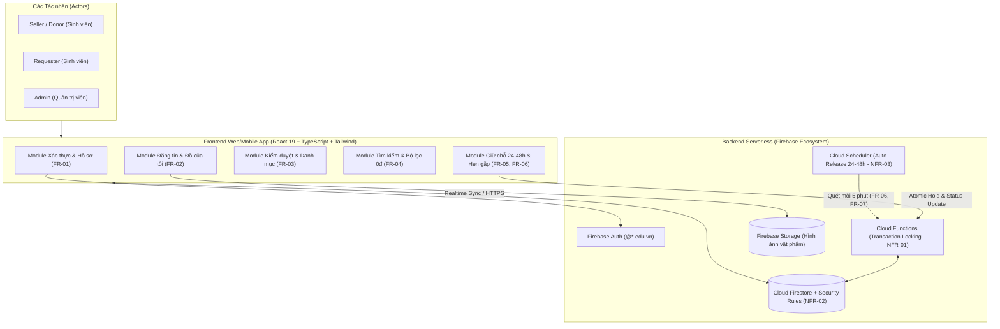
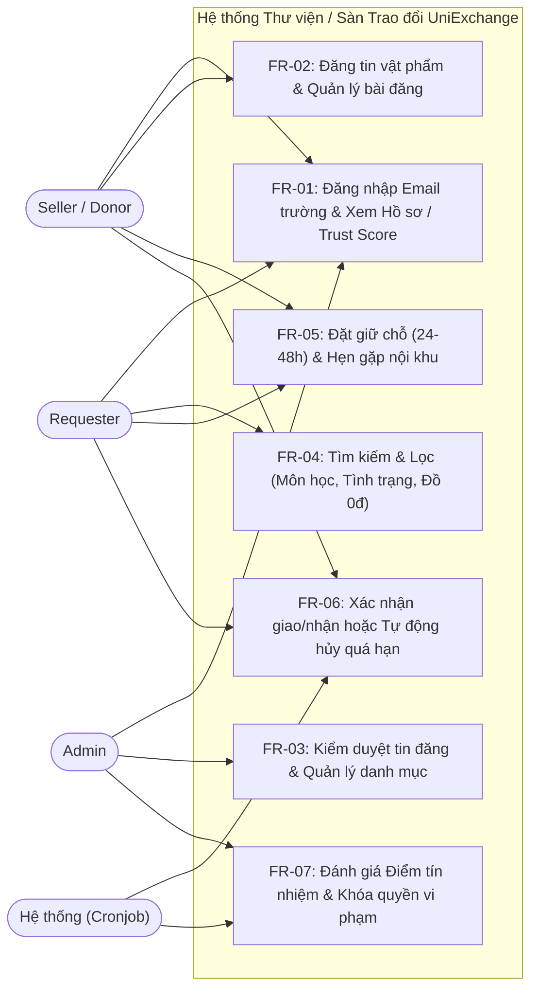
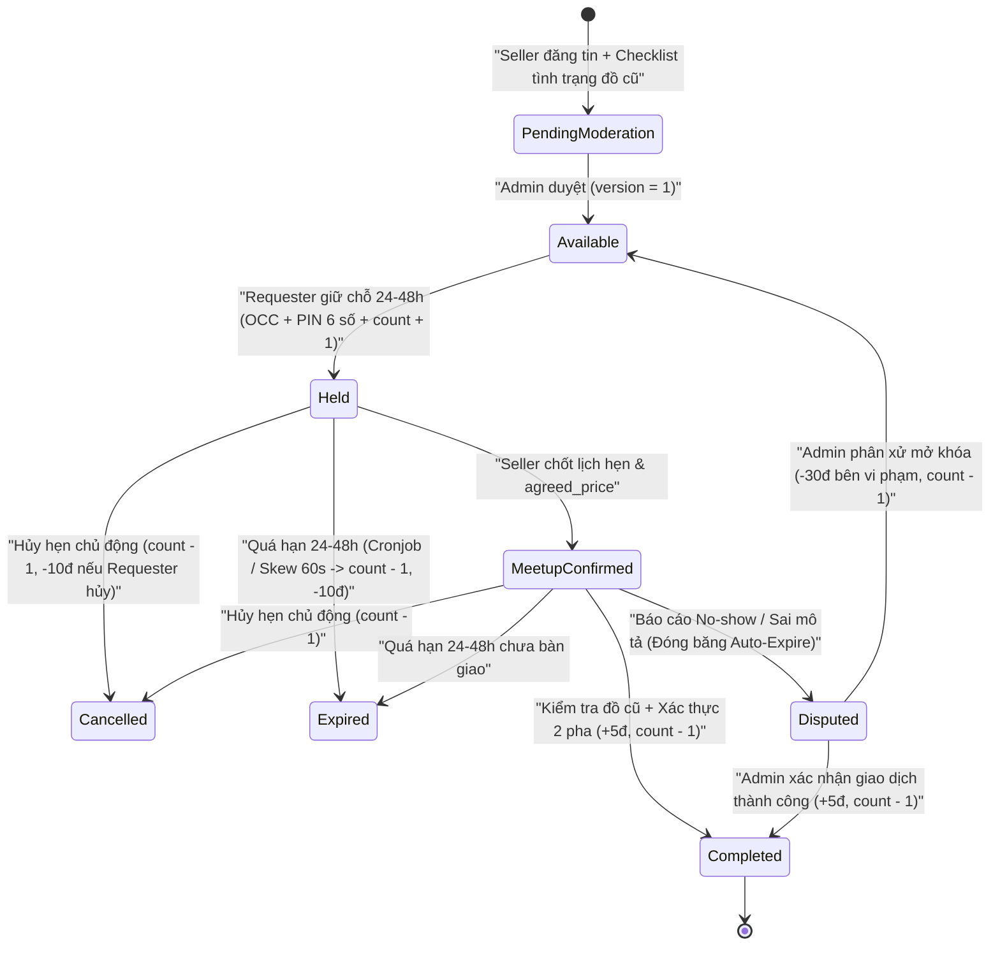
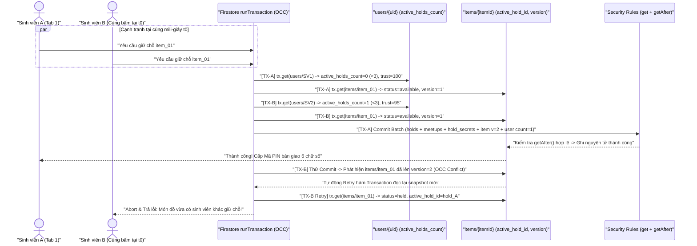

# TÀI LIỆU ĐẶC TẢ YÊU CẦU PHẦN MỀM HOÀN CHỈNH (SRS)

**Tên đề tài:** Hệ thống Thư viện / Sàn Trao đổi Giáo trình & Thiết bị Cũ trong Trường học (**UniExchange**)  
**Phiên bản:** 2.1 (Nâng cấp Nghiệp vụ Giao dịch Đồ cũ, Transaction Management & Concurrency Control)  
**Tiêu chuẩn áp dụng:** IEEE Std 830-1998 / ISO/IEC/IEEE 29148:2018  
**Hạng mục bàn giao:** WBS 1.2 – 1.4 (Tài liệu SRS hoàn chỉnh & Đặc tả chi tiết Use Case)  

### Danh sách Thành viên Thực hiện & Phân công Trách nhiệm (Theo WBS)

| Ký hiệu | Họ và tên | Vai trò chính (Role) | Trách nhiệm cốt lõi trong đồ án |
| :---: | :--- | :--- | :--- |
| **TV1** | **Thành Đạt** | Project Manager (PM) & Backend Core | Quản lý tiến độ, thiết kế kiến trúc hệ thống, xử lý nghiệp vụ giữ chỗ (`Hold 24–48h`) & Khóa tài nguyên chống `Race Condition` (`FR-05`, `NFR-01`). |
| **TV2** | **Quốc Dũng** | Database Engineer (DB) & Backend | Thiết kế sơ đồ ERD, đặc tả CSDL (`NFR-02`), xây dựng module Điểm tín nhiệm (`Trust Score` - `FR-07`) và tiến trình tự động `Cronjob` (`FR-06`, `NFR-03`). |
| **TV3** | **Văn Dệ** | Business Analyst (BA) & Backend | Viết đặc tả SRS, vẽ sơ đồ UML (Use Case, Activity), xây dựng nghiệp vụ Đăng tin (`FR-02`), Kiểm duyệt Admin (`FR-03`) & Tìm kiếm/Lọc (`FR-04`). |
| **TV4** | **Tiến Thắng** | UI/UX Designer & Frontend Lead (FE) | Thiết kế giao diện Figma, lập trình giao diện Web/App cho 3 Actors, ghép nối API và phụ trách kịch bản Kiểm thử (`WBS 4.1`). |

---

## 1. Giới thiệu (Introduction)

### 1.1. Tên đề tài
**Hệ thống Thư viện / Sàn Trao đổi Giáo trình & Thiết bị Cũ trong Trường học** (Tên định danh sản phẩm: **UniExchange**).

### 1.2. Mục tiêu hệ thống (System Objectives)
1. **Giảm thiểu lãng phí tài nguyên học tập:** Giải quyết tình trạng lãng phí sách giáo trình, máy tính bỏ túi, dụng cụ thực hành và tài liệu ôn thi của sinh viên khóa trên sau khi ra trường hoặc kết thúc môn học.
2. **Tiết kiệm chi phí cho sinh viên:** Giúp sinh viên khóa dưới tiếp cận nguồn học liệu chất lượng thông qua hai hình thức: **Tặng miễn phí (`0 đồng`)** hoặc **Nhượng lại với mức giá tượng trưng**.
3. **Xây dựng môi trường trao đổi văn minh, an toàn:** Tổ chức giao nhận trực tiếp tại các điểm hẹn công khai ngay trong khuôn viên trường học, kết hợp cơ chế kiểm duyệt nội dung và đánh giá **Điểm tín nhiệm (`Trust Score`)** tự động để ngăn chặn spam, bán hàng thương mại và bùng hẹn.

### 1.3. Phạm vi hệ thống (Scope)
Ứng dụng Web/Mobile Responsive nội bộ dành riêng cho **sinh viên** và **ban quản trị** trong trường đại học, bao gồm trọn vẹn quy trình khép kín: Xác thực bằng tài khoản sinh viên → Đăng tin vật phẩm → Kiểm duyệt bài đăng → Tìm kiếm & Lọc (theo môn học, tình trạng, đồ 0 đồng) → Đặt giữ chỗ độc quyền 24–48h & Hẹn gặp nội khu → Xác nhận giao/nhận hoặc tự động mở khóa khi quá hạn → Cộng/trừ Điểm tín nhiệm.

### 1.4. Định nghĩa, Thuật ngữ và Từ viết tắt

| Thuật ngữ | Giải thích nghiệp vụ |
| :--- | :--- |
| **Seller / Donor** | *Người cho / Người bán* — Sinh viên sở hữu giáo trình, thiết bị cũ đăng bài tặng (`0đ`) hoặc bán lại giá tượng trưng. |
| **Requester** | *Người nhận / Người mua* — Sinh viên tìm kiếm, đặt giữ chỗ và hẹn gặp để nhận/mua giáo trình, thiết bị. |
| **Admin** | *Quản trị viên* — Người kiểm duyệt bài đăng, quản lý danh mục môn học/điểm hẹn và giám sát điểm tín nhiệm. |
| **Hold (Giữ chỗ)** | Cơ chế khóa tạm thời vật phẩm trong 24–48 giờ cho duy nhất 01 `Requester` để hai bên gặp mặt trao đổi. |
| **Meetup (Hẹn gặp)** | Thỏa thuận thời gian và địa điểm gặp mặt an toàn trong khuôn viên trường (Thư viện, Sảnh nhà A, Căn tin...). |
| **Trust Score** | *Điểm tín nhiệm* — Chỉ số uy tín của sinh viên (khởi tạo `100` điểm), tự động tăng/giảm dựa trên lịch sử cam kết giao dịch. |
| **No-show** | Hành vi sinh viên đặt giữ chỗ và chốt lịch hẹn nhưng không xuất hiện tại điểm hẹn và không báo hủy hợp lệ. |
| **Race Condition** | Xung đột đồng thời khi nhiều `Requester` cùng bấm "Giữ chỗ" trên 1 vật phẩm tại cùng một thời điểm (cùng 1 giây). |
| **Handover PIN (OTP Bàn giao)** | Mã xác thực 6 chữ số chỉ cấp riêng cho `Requester` để đối chiếu bàn giao vật lý 2 pha tại điểm hẹn trong khuôn viên trường. |
| **Write Skew** | Dị thường đồng thời xảy ra khi một sinh viên gửi nhiều yêu cầu song song trên các vật phẩm rời rạc nhằm vượt hạn mức giữ chỗ đồng thời. |
| **Fencing Version** | Số hiệu phiên bản đơn điệu (`version`) trên tài liệu giúp phát hiện cập nhật cũ và tuần tự hóa giao dịch chống ghi đè trạng thái. |
| **Disputed Freeze** | Trạng thái đóng băng phiên giữ chỗ khi phát sinh báo cáo Bùng hẹn (*No-show*) hoặc đồ cũ sai mô tả, ngăn tiến trình tự động trừ điểm nhầm của người mua. |

### 1.5. Tài liệu tham chiếu
- Tài liệu Đặc tả Yêu cầu Phần mềm Sơ bộ (*Preliminary SRS*) & Bảng Phân rã Công việc (*WBS*).
- Đặc tả Cơ sở dữ liệu: `Dac_Ta_CSDL.md` (v2.1) & Sơ đồ thực thể kết hợp: `erd_system.drawio`.
- Đặc tả Bảo mật & Phân quyền: `security_spec.md` & `firestore.rules`.

### 1.6. Phân tích Tham chiếu Hệ thống Thực tế (Chợ Tốt, Karrot) & Định vị Nghiệp vụ Đồ cũ Nội khu

Để khắc phục hạn chế của mô hình đăng tin – nhận đồ đơn giản và tập trung vào các nghiệp vụ cốt lõi của một sàn giao dịch đồ cũ tin cậy, UniExchange tham chiếu có chọn lọc cơ chế từ **Chợ Tốt** (Việt Nam) và **Karrot / 당근마켓** (Hàn Quốc – mô hình trao đổi đồ cũ cộng đồng theo khu vực tin cậy) để thiết kế quy trình đặc thù cho khuôn viên đại học:

| Khía cạnh Nghiệp vụ | Tham chiếu **Chợ Tốt** | Tham chiếu **Karrot (당근마켓)** | Thiết kế Chuẩn hóa trong **UniExchange** |
| :--- | :--- | :--- | :--- |
| **1. Định danh & Chỉ số uy tín** | Xác thực SĐT/tài khoản, đánh giá người bán theo sao và lịch sử giao dịch. | Xác thực vùng sinh sống (*Neighborhood*), chỉ số nhiệt độ uy tín (*Manner Temperature*). | Bắt buộc định danh sinh viên trường, chỉ số `Trust Score` khởi tạo `100` (`0..200`), khóa giữ chỗ khi `< 50` và sổ cái `trust_history` đối soát bất biến. |
| **2. Định giá & Thương lượng đồ cũ** | Cho phép trả giá công khai qua chat trước khi chốt đơn. | Đề xuất mức giá trực tiếp trên món đồ kèm mức giá mong muốn (*Price Offer*). | Phân tách rõ **Tặng 0đ** (`gift`, cố định `0đ`) và **Nhượng giá tượng trưng** (`sell`, kèm trường đề xuất **Giá thương lượng `offered_price`** trong biên độ `50%–100%` giá niêm yết và khóa thành `agreed_price` khi chốt lịch). |
| **3. Kiểm định tình trạng đồ cũ thực tế** | Mô tả hiện trạng cũ/mới, ảnh chụp thực tế, kiểm hàng khi gặp mặt. | Nhấn mạnh mô tả khuyết điểm đồ cũ rõ ràng để tránh hiểu nhầm lúc gặp mặt. | Chuẩn hóa **Checklist tình trạng học liệu/thiết bị** (gáy sách/ghi chú chì đối với sách; pin/nút bấm/phụ kiện đối với thiết bị) ngay khi đăng (`FR-02.2`) và đối chiếu trực tiếp trước khi bàn giao. |
| **4. Khóa giữ chỗ độc quyền & Chống gom hàng** | Chưa khóa cứng tài nguyên khi nhiều người cùng hỏi mua; dễ trùng đơn. | Trạng thái *Reserved (Đang hẹn)* thủ công bởi người bán trên từng bài đăng. | Khóa giữ chỗ nguyên tử `24–48h` bằng `Firestore runTransaction` (`active_hold_id` + `items.version`) kết hợp hạn mức tối đa **`3` phiên giữ chỗ đồng thời (`active_holds_count <= 3`)** chống *Write Skew* gom đồ 0đ đầu kỳ. |
| **5. Xác thực bàn giao vật lý 2 pha** | Giao dịch *Chợ Tốt Đảm Bảo* hoặc tự thỏa thuận tay trao tay. | Gặp trực tiếp tại điểm công khai trong khu dân cư và xác nhận hoàn tất hai chiều. | Hẹn gặp bắt buộc tại **Điểm hẹn an toàn nội khu** (Thư viện, Sảnh nhà A, Căn tin...) kèm **Xác thực bàn giao 2 pha** bằng **Mã PIN 6 số (`handover_pin`)** hoặc xác nhận từ `Requester` (`buyer_confirmed`), chặn hoàn tất khống một chiều. |
| **6. Chế tài Bùng hẹn (*No-show*) & Đóng băng tranh chấp** | Khiếu nại sau sự cố; xử lý rời rạc ngoài luồng giữ chỗ. | Đánh giá tiêu cực *No-show* làm tụt *Manner Temperature* nhanh. | Tự động mở khóa & trừ `-10` điểm khi hủy/quá hạn; hỗ trợ trạng thái **Đóng băng Tranh chấp (`Disputed Freeze`)** khi gặp *No-show* hoặc đồ cũ sai mô tả để chặn trừ điểm oan và chuyển Admin phân xử (`-30` điểm). |

---

## 2. Tổng quan về Người dùng & Kiến trúc (Overall Description)

### 2.1. Phân loại Người dùng (User Classes and Characteristics)
Hệ thống bao gồm **03 tác nhân con người (Human Actors)** chính và **01 tác nhân hệ thống tự động**:

1. **Người cho/bán (`Seller / Donor`):**
   - Là sinh viên trong trường có nhu cầu đăng tặng (`0đ`) hoặc nhượng lại giáo trình, tài liệu, thiết bị học tập cũ.
   - Thực hiện: Đăng tin kèm ảnh & tình trạng vật phẩm, theo dõi trạng thái bài đăng, phối hợp thời gian/địa điểm hẹn gặp và xác nhận đã giao đồ.
2. **Người nhận/mua (`Requester`):**
   - Là sinh viên có nhu cầu tìm kiếm học liệu theo môn học, lọc đồ miễn phí, đặt giữ chỗ trong 24–48h và đến điểm hẹn nhận đồ.
   - **Lưu ý quan trọng:** Một tài khoản sinh viên (`role = "student"`) **có thể đóng đồng thời cả 2 vai trò `Seller/Donor` và `Requester`** trên hệ thống (nhưng không được phép tự giữ chỗ vật phẩm do chính mình đăng).
3. **Quản trị viên (`Admin`):**
   - Cán bộ quản lý thư viện / Đoàn Thanh niên / Hội Sinh viên nhà trường (`role = "admin"`).
   - Thực hiện: Kiểm duyệt duyệt/từ chối bài đăng mới chống spam/thương mại hóa, quản lý danh mục gốc (môn học, danh mục vật phẩm, điểm hẹn an toàn) và giám sát/xử lý vi phạm điểm tín nhiệm.
4. **Hệ thống tự động (`System / Scheduler`):**
   - Tác nhân nền vận hành qua Database Transaction & Cronjob định kỳ để tự động hủy giữ chỗ quá hạn (`Release Hold` sau 24–48h), tự động trừ điểm uy tín và khóa quyền nhận đồ khi điểm dưới ngưỡng tối thiểu.

### 2.2. Kiến trúc Tổng thể Hệ thống

---

## 3. Đặc tả Chi tiết Yêu cầu Chức năng (Detailed Functional Requirements)

### 3.1. Sơ đồ Use Case Tổng quát theo 3 Actors

---

### 3.2. Đặc tả từng Nhóm Yêu cầu Chức năng (`FR-01` → `FR-07`)

#### `FR-01`: Xác thực & Hồ sơ (Authentication & Profile)
- **Actor thực hiện:** `Seller`, `Requester`, `Admin`.
- **Mục tiêu:** Định danh chính xác sinh viên thuộc trường, cung cấp thông tin hồ sơ và hiển thị minh bạch Điểm tín nhiệm hiện tại.
- **Tiền điều kiện:** Người dùng truy cập ứng dụng và mở màn hình Đăng nhập.
- **Hậu điều kiện:** Phiên xác thực được khởi tạo hợp lệ; hồ sơ người dùng đồng bộ với `users/{uid}`.
- **Chi tiết yêu cầu con:**
  - **`FR-01.1` (Đăng nhập tài khoản sinh viên):** Hỗ trợ đăng nhập bằng Email nhà trường cấp (`@*.edu.vn` qua Email/Password hoặc Google Workspace trường) và xác thực bổ sung.
  - **`FR-01.2` (Khởi tạo hồ sơ sinh viên):** Lần đầu đăng nhập, hệ thống tự động tạo bản ghi người dùng gồm: Mã số sinh viên (`student_id_code`), Họ tên (`full_name`), Email, SĐT (`phone_number`), vai trò mặc định (`student`), trạng thái `active` và **Điểm tín nhiệm khởi tạo (`current_trust_score`) = `100`**.
  - **`FR-01.3` (Xem thông tin cá nhân & Điểm tín nhiệm):** Hiển thị trực quan Họ tên, Ảnh đại diện, Điểm tín nhiệm hiện tại (`current_trust_score`) ngay trên thanh điều hướng và cho phép xem lịch sử biến động điểm (`trust_history`).
  - **`FR-01.4` (Bảo vệ phân quyền):** Sinh viên chỉ được sửa thông tin cá nhân (`student_id_code`, `full_name`, `avatar_url`, `phone_number`); tuyệt đối không thể tự sửa `role` hoặc `current_trust_score`.

---

#### `FR-02`: Đăng tin vật phẩm (Post & Manage Items)
- **Actor thực hiện:** `Seller / Donor`.
- **Mục tiêu:** Cho phép sinh viên đăng tặng hoặc nhượng lại sách giáo trình, thiết bị học tập cũ kèm đầy đủ thông tin học phần và tình trạng thực tế.
- **Tiền điều kiện:** Người dùng đã đăng nhập hợp lệ và tài khoản không bị đình chỉ (`status == "active"`).
- **Hậu điều kiện:** Hình ảnh được tải lên Cloud Storage; bản ghi vật phẩm mới được tạo với trạng thái kiểm duyệt `pending` chờ Admin duyệt trước khi hiển thị công khai.
- **Chi tiết yêu cầu con:**
  - **`FR-02.1` (Nhập thông tin & Phân loại môn học):** Bắt buộc nhập Tiêu đề (`<= 100` ký tự), chọn Danh mục (`category_id`: `giao-trinh`, `thiet-bi`, `tai-lieu`, `khac`), chọn/gắn Mã môn học (`subject_id`) theo chương trình đào tạo.
  - **`FR-02.2` (Hình ảnh & Checklist Tình trạng Đồ cũ Thực tế):** Tải lên ảnh thực tế (`PNG`/`JPG`/`JPEG`/`WEBP`, `< 5MB`), chọn mức độ mới (`condition_level`: `new_99`, `used_good`, `used_acceptable`) và khai báo rõ **Checklist tình trạng đồ cũ** trong mô tả chi tiết (`<= 1000` ký tự): tình trạng gáy sách, vết đánh dấu/ghi chú chì (đối với giáo trình/tài liệu) hoặc tình trạng pin, nút bấm, phụ kiện đi kèm (đối với máy tính bỏ túi/dụng cụ thực hành) làm căn cứ đối chiếu khi bàn giao tại điểm hẹn.
  - **`FR-02.3` (Hình thức Tặng 0đ hoặc Giá tượng trưng):** Cho phép chọn Tặng miễn phí (`item_type = "gift"`, `price = 0 VND`) hoặc Nhượng lại với giá tượng trưng (`item_type = "sell"`, `price > 0`).
  - **`FR-02.4` (Quản lý bài đăng cá nhân):** Xem danh sách `Đồ của tôi` theo các trạng thái (`Chờ duyệt`, `Sẵn sàng trên sàn`, `Đang được giữ chỗ`, `Đã trao đổi xong`, `Bị từ chối`); cho phép chỉnh sửa hoặc xóa tin khi vật phẩm **chưa bị đặt giữ chỗ** (`item_status != "held"`).

---

#### `FR-03`: Kiểm duyệt tin đăng & Quản trị danh mục (Moderation & Master Data)
- **Actor thực hiện:** `Admin`.
- **Mục tiêu:** Đảm bảo mọi bài đăng tuân thủ nội quy học đường, ngăn chặn tin rác (spam), vật phẩm cấm hoặc buôn bán thương mại trá hình.
- **Tiền điều kiện:** Người dùng đăng nhập với tài khoản có quyền `role == "admin"`.
- **Hậu điều kiện:** Bài đăng hợp lệ chuyển sang `moderation_status = "approved"` để hiển thị lên Sàn trao đổi; mọi quyết định kiểm duyệt đều được ghi vết vào `moderation_logs`.
- **Chi tiết yêu cầu con:**
  - **`FR-03.1` (Duyệt bài đăng - Approve):** Admin xem danh sách bài đăng chờ duyệt (`pending`), kiểm tra hình ảnh/mức giá/nội dung và nhấn **Duyệt** để xuất bản lên sàn (`item_status = "available"`).
  - **`FR-03.2` (Từ chối / Ẩn bài đăng - Reject/Hide):** Admin từ chối bài đăng vi phạm kèm **Lý do từ chối** bắt buộc (VD: *Giá bán cao hơn giá bìa*, *Không phải đồ dùng học tập*, *Ảnh mờ/spam*) để `Seller` biết và chỉnh sửa.
  - **`FR-03.3` (Quản lý danh mục hệ thống):** Admin thêm mới, cập nhật hoặc vô hiệu hóa danh sách **Môn học (`subjects`)**, **Danh mục vật phẩm (`categories`)** và **Điểm hẹn an toàn trong trường (`meetup_locations`)**.

---

#### `FR-04`: Tìm kiếm & Lọc vật phẩm (Search & Filter)
- **Actor thực hiện:** `Requester` (và mọi sinh viên xem sàn).
- **Mục tiêu:** Giúp sinh viên khóa dưới nhanh chóng tìm đúng cuốn giáo trình hoặc thiết bị cần thiết theo môn học và ngân sách.
- **Tiền điều kiện:** Chỉ hiển thị các vật phẩm đã được duyệt (`moderation_status == "approved"`) và đang sẵn sàng (`item_status == "available"`).
- **Chi tiết yêu cầu con:**
  - **`FR-04.1` (Tìm kiếm từ khóa):** Tìm kiếm tức thời không phân biệt hoa thường theo **Tên giáo trình/thiết bị** hoặc **Tên/Mã môn học** (VD: `INT1340`, `Giải tích 1`).
  - **`FR-04.2` (Lọc theo Danh mục & Tình trạng):** Bộ lọc kết hợp theo loại vật phẩm (`category_id`) và mức độ mới (`condition_level`).
  - **`FR-04.3` (Lọc nhanh Đồ miễn phí 0 đồng):** Cung cấp bộ lọc chuyên biệt **"Tặng miễn phí (0 đồng)"** giúp sinh viên lọc ngay toàn bộ học liệu được khóa trên trao tặng (`item_type == "gift"` / `price == 0`).
  - **`FR-04.4` (Đồng bộ hiển thị Realtime):** Ngay khi một món đồ được người khác bấm giữ chỗ thành công, món đồ đó lập tức ẩn khỏi danh sách tìm kiếm hoặc đổi nhãn trạng thái theo thời gian thực.

---

#### `FR-05`: Giữ chỗ, Thương lượng giá & Hẹn gặp nội khu (Hold, Price Offer & Meetup)
- **Actor thực hiện:** `Requester`, `Seller`.
- **Mục tiêu:** Đặt khóa độc quyền món đồ trong 24–48 giờ (tối đa `3` phiên đang hoạt động mỗi sinh viên), đề xuất mức giá tượng trưng hợp lý cho đồ cũ có phí và thống nhất thời gian, địa điểm giao nhận an toàn ngay trong khuôn viên trường.
- **Tiền điều kiện:**
  1. `Requester` đã đăng nhập, `status == "active"` và có Điểm tín nhiệm đạt mức tối thiểu (`current_trust_score >= 50`).
  2. `Requester` không phải là chủ bài đăng (`requester_id != seller_id`).
  3. Vật phẩm đã duyệt (`moderation_status == "approved"`) và đang ở trạng thái `item_status == "available"` (`active_hold_id == null`).
  4. `Requester` chưa vượt hạn mức giữ chỗ đồng thời (`active_holds_count < 3`) và không trong thời gian bị khóa (`hold_locked_until == null || hold_locked_until <= now`).
- **Hậu điều kiện:** Vật phẩm chuyển sang trạng thái `item_status = "held"` và tăng `version + 1`; bộ đếm `users/{requester_id}.active_holds_count` tăng `+1`; bản ghi `holds/{holdId}`, lịch hẹn `meetups/{holdId}` và mật mã bàn giao `hold_secrets/{holdId}` (chứa `handover_pin` 6 chữ số) được khởi tạo nguyên tử với hạn `hold_expires_at` sau 24–48 giờ.
- **Chi tiết yêu cầu con:**
  - **`FR-05.1` (Đặt giữ chỗ 24–48h chống tranh chấp & chống Write Skew):** Khi `Requester` bấm **Đặt giữ chỗ**, hệ thống thực thi trong một `Firestore runTransaction` (OCC, xem `NFR-01`): kiểm tra và tăng `users/{requester_id}.active_holds_count + 1` (ràng buộc `<= 3`), gán `items/{itemId}.active_hold_id = newHoldId`, tăng `items/{itemId}.version + 1`, đồng thời sinh bản ghi mật `hold_secrets/{holdId}` chứa `handover_pin` 6 chữ số.
  - **`FR-05.2` (Thương lượng giá tượng trưng & Chọn Địa điểm/Thời gian hẹn nội khu):** Đối với vật phẩm có phí (`item_type == "sell"`), `Requester` có thể giữ nguyên giá đăng hoặc đề xuất **giá thương lượng (`offered_price`)** trong biên độ `50%–100%` giá niêm yết (với đồ `gift`, giá cố định `0đ`). `Requester` chọn một địa điểm an toàn trong khuôn viên trường (`meetup_locations`), đề xuất **Thời gian hẹn gặp cụ thể (`proposed_time`)** nằm trong khung 24–48h giữ chỗ và ghi chú nhận diện (`note`).
  - **`FR-05.3` (Chốt lịch hẹn, Khóa giá thỏa thuận & Phối hợp giữa hai bên):** Cả `Requester` và `Seller` theo dõi thông tin lịch hẹn, SĐT liên lạc và đồng hồ đếm ngược thời hạn giữ chỗ. `Seller` bấm **Chốt lịch hẹn** (`status = "confirmed"`) đồng thời khóa mức giá thỏa thuận cuối (`agreed_price`), hoặc hai bên đề xuất dời giờ/đổi điểm hẹn (`rescheduled`) trong thời hạn giữ chỗ. `Requester` xem được `handover_pin` 6 chữ số và checklist kiểm tra đồ cũ trên thẻ giữ chỗ của mình.

---

#### `FR-06`: Quản lý Vòng đời Giao dịch Đồ cũ, Bàn giao 2 Pha & Xử lý Tranh chấp (Transaction Lifecycle, 2-Phase Handover & Dispute Resolution)
- **Actor thực hiện:** `Seller`, `Requester`, `Admin`, `Hệ thống (Scheduler)`.
- **Mục tiêu:** Đảm bảo mọi phiên giữ chỗ đồ cũ đi qua đúng vòng đời khép kín, xác thực có gặp mặt & kiểm tra đồ thực tế trước khi chốt hoàn tất, tự động mở khóa đúng hạn khi quá 24–48h và bảo vệ quyền lợi các bên nếu xảy ra bùng hẹn (*No-show*) hoặc đồ cũ sai mô tả.

- **Chi tiết yêu cầu con:**
  - **`FR-06.1` (Xác thực bàn giao vật lý 2 pha & Chốt giao dịch):** Tại điểm hẹn, `Requester` kiểm tra trực tiếp tình trạng đồ cũ đối chiếu với checklist lúc đăng (`FR-02.2`); nếu đạt yêu cầu, `Requester` đọc mã `handover_pin` 6 chữ số cho `Seller` nhập (hoặc bấm xác nhận `buyer_confirmed = true`) để `Seller` hoàn tất giao dịch nguyên tử: `hold_status = "converted"`, `item_status = "completed"`, `active_hold_id = null`, tăng `items.version + 1`, giảm `users/{requester_id}.active_holds_count - 1`, ghi nhận biên bản `transactions` (với `final_amount = agreed_price`, `handover_method`) kèm `status_logs` và cộng `+5` điểm uy tín cho `Requester`. Chặn hoàn toàn việc `Seller` tự bấm hoàn tất khống khi chưa gặp mặt.
  - **`FR-06.2` (Chủ động hủy giữ chỗ):** Cho phép `Requester` hoặc `Seller` hủy hẹn kèm lý do (`cancel_reason`). Hệ thống đổi nguyên tử `hold_status = "cancelled"`, giảm `users/{requester_id}.active_holds_count - 1`, trả `item_status = "available"` (`active_hold_id = null`, `items.version + 1`), hủy meetup; nếu `Requester` chủ động hủy thì trừ `-10` điểm uy tín (`CANCEL_HOLD`).
  - **`FR-06.3` (Tự động hủy giữ chỗ quá hạn - Dual-Trigger Auto Release):** Vận hành kết hợp giữa *Scheduled Cronjob* (`Cloud Scheduler` + `Cloud Functions` mỗi 5 phút) và *Client Lazy Sweep* (truy vấn với **biên độ an toàn chống lệch đồng hồ 60 giây**: `Date.now() - 60_000` so với `request.time`). Chỉ quét các phiên có `hold_status == "active"` (tuyệt đối bỏ qua `disputed`); khi quá hạn, đổi `hold_status = "expired"`, giảm `active_holds_count - 1`, khôi phục `item_status = "available"` (`active_hold_id = null`) và trừ `-10` điểm (`EXPIRED_HOLD`).
  - **`FR-06.4` (Đóng băng Tranh chấp & Báo cáo Bùng hẹn — `Disputed Freeze`):** Nếu quá giờ hẹn `proposed_time` mà đối phương không xuất hiện (*No-show*) hoặc vật phẩm cũ bị hư hỏng/sai khác nghiêm trọng so với mô tả, bên bị ảnh hưởng có quyền gửi báo cáo để chuyển nguyên tử `hold_status = "disputed"` (lưu `dispute_reason`, `disputed_by`, `disputed_at`). Phiên ở trạng thái `disputed` sẽ **đóng băng tiến trình tự động quá hạn**, ngăn trừ `-10` điểm oan của người mua và đưa vào hàng đợi để `Admin` phân xử nguyên tử (xác minh lý do, phạt `-30` điểm `NO_SHOW` đối với bên vi phạm, giảm `active_holds_count - 1`, trả vật phẩm về `available` hoặc chốt `completed`).

---

#### `FR-07`: Đánh giá tín nhiệm (Trust Score System)
- **Actor thực hiện:** `Hệ thống`, `Admin`.
- **Mục tiêu:** Khuyến khích văn hóa đúng hẹn, ngăn chặn hành vi "giữ chỗ ảo / gom sách miễn phí rồi bỏ hẹn" làm mất cơ hội của sinh viên khác.
- **Chi tiết quy tắc tính điểm & chế tài (`BR-TRUST`):**

| Sự kiện nghiệp vụ | Mã sự kiện | Điểm biến động | Cơ chế xử lý của Hệ thống |
| :--- | :---: | :---: | :--- |
| Khởi tạo tài khoản sinh viên mới | `INIT` | **`100` (Mặc định)** | Cấp đầy đủ quyền đăng bài và đặt giữ chỗ. |
| Giao dịch trao đổi hoàn tất thành công | `COMPLETE_TX` | **`+5`** | Cộng điểm uy tín (biên độ tích lũy `[0, 200]`), ghi vào `trust_history`. |
| Quá hạn giữ chỗ 24–48h không giao dịch / `Requester` tự hủy hẹn | `CANCEL_HOLD` / `EXPIRED_HOLD` | **`-10`** | Tự động trừ điểm ngay khi `Requester` hủy hoặc khi tiến trình quét quá hạn 24–48h. |
| Không đến điểm hẹn mà không báo hủy (*No-show*) | `NO_SHOW` | **`-30`** | Trừ nặng điểm uy tín khi xác nhận báo cáo bùng hẹn từ đối phương / Admin. |
| Admin điều chỉnh khi giải quyết khiếu nại | `ADMIN_ADJUST` | **Tùy chỉnh** | Admin khôi phục hoặc trừ điểm kèm lý do minh bạch trong sổ cái `trust_history`. |
| **Điểm tín nhiệm dưới mức tối thiểu (`< 50`)** | `LOCK_HOLD` | **Khóa quyền nhận** | **Tự động khóa quyền "Đặt giữ chỗ" trong `7` ngày (`hold_locked_until`)** đối với tài khoản vi phạm. |

- **Ràng buộc Toán học & Bất biến Sổ cái Điểm tín nhiệm:**
  - **Biên độ & Công thức kẹp chính xác (`Clamped Applied Delta`):** Điểm uy tín luôn nằm trong khoảng nguyên đóng `[0, 200]`. Khi áp dụng biến động `delta`, hệ thống tính `newBalance = clamp(0, 200, currentScore + delta)` và ghi nhận `appliedDelta = newBalance - currentScore` làm `score_change` vào `trust_history` (đảm bảo tại hai đầu cận `0` hoặc `200`, `score_change` luôn bằng đúng hiệu số thực tế thay vì `+5` hay `-10` thô).
  - **Sổ cái Xác định & Chống Phát lại (*Deterministic Idempotent Ledger IDs*):** Tài liệu trong `users/{userId}/trust_history/{logId}` bắt buộc sử dụng ID xác định theo nghiệp vụ: `INIT`, `COMPLETE_TX_<holdId>`, `CANCEL_HOLD_<holdId>`, `EXPIRED_HOLD_<holdId>` (kèm trường đối soát `last_trust_ref_id` trên `users/{userId}` để `firestore.rules` kiểm tra qua `get()` / `getAfter()`), ngăn chặn 100% lỗi cộng/trừ điểm kép khi transaction retry hoặc khi bị gọi lại trái phép.
  - **Tự động khóa quyền giữ chỗ (`< 50` điểm):** Ngay trong transaction làm `newBalance < 50`, trường `hold_locked_until` được gán bằng `now + 7 ngày`, khóa ngay lập tức quyền đặt giữ chỗ mới cho đến khi hết hạn khóa và được khôi phục điểm `>= 50`.

---

## 4. Yêu cầu Phi chức năng Trọng tâm (Core Non-Functional Requirements)

### 4.1. `NFR-01` — Quản lý Giao dịch Nguyên tử & Kiểm soát Đồng thời (Transaction Management & Concurrency Control)

#### 4.1.1. Cơ chế Giao dịch ACID & Khóa Lạc quan OCC trên Cloud Firestore (`OPTIMISTIC` Mode)
Trên Cloud Firestore của hệ thống (`FIRESTORE_NATIVE`, `concurrencyMode: OPTIMISTIC`), toàn bộ thao tác thay đổi trạng thái giữ chỗ, khóa vật phẩm, lịch hẹn, hợp đồng giao dịch và điểm tín nhiệm được bảo vệ bởi **02 tầng kiểm soát nguyên tử**:

1. **Tầng Giao dịch Ứng dụng / Backend (`Firestore runTransaction` — Optimistic Concurrency Control - OCC):**
   - **Pha 1 — Strict Reads-Before-Writes (*Đọc toàn bộ trước khi ghi*):** Mọi lệnh `tx.get(...)` (`users/{requesterId}`, `items/{itemId}`, `holds/{holdId}`, `meetups/{holdId}`, `hold_secrets/{holdId}`) bắt buộc phải thực thi **trước bất kỳ lệnh `tx.set` / `tx.update` nào** để thiết lập *Read-Set* kèm số hiệu phiên bản (`updateTime` / `etag`) trên server.
   - **Pha 2 — Snapshot Validation & Write Buffering (*Kiểm tra điều kiện & Đệm ghi*):** Hệ thống kiểm tra lại mọi bất biến nghiệp vụ trên dữ liệu mới nhất vừa đọc từ server (không bao giờ tin trạng thái cache trên giao diện Client). Các lệnh ghi được gom vào một *Atomic Batch*.
   - **Pha 3 — Read-Set Verification, Atomic Commit & Auto-Retry (*Đối chiếu phiên bản & Thử lại tối đa 5 lần*):** Tại thời điểm Commit, Firestore đối chiếu toàn bộ tài liệu trong *Read-Set*. Nếu có **bất kỳ** tài liệu nào vừa bị một phiên đồng thời khác sửa đổi dù chỉ chênh `1 ms`, giao dịch nhận xung đột `ABORTED`, tự động hủy phần ghi đệm và chạy lại hàm transaction tối đa 5 lần để đọc snapshot mới nhất. Hoặc tất cả tài liệu cập nhật thành công cùng lúc (**Atomicity**), hoặc toàn bộ bị hủy không để lại dữ liệu mồ côi.
2. **Tầng Hậu kiểm Bảo mật Zero-Trust (`Firestore Security Rules` — `get()` & `getAfter()`):**
   - Kể cả khi người dùng cố tình gửi request ghi lẻ từ REST API bỏ qua `runTransaction`, Security Rules vẫn sử dụng `get()` (trạng thái trước Commit) và `getAfter()` (trạng thái dự kiến sau toàn bộ Commit) để ép buộc các tài liệu liên quan (`holds`, `items`, `users`, `meetups`, `trust_history`) phải biến đổi đồng bộ trong cùng một đơn vị nguyên tử, nếu lệch sẽ từ chối toàn bộ với `PERMISSION_DENIED`.

#### 4.1.2. Giải quyết 04 Bài toán Xung đột Đồng thời Cốt lõi (Concurrency Anomalies)

| # | Bài toán Xung đột (*Anomaly*) | Kịch bản thực tế trên Sàn Đồ cũ | Cơ chế Khóa & Kiểm soát Xung đột của UniExchange |
| :-: | :--- | :--- | :--- |
| **1** | **Lost Update / Double-Booking** (`N` người → `1` món đồ) | Đầu học kỳ, `>= 10` sinh viên cùng bấm **"Đặt giữ chỗ"** vào 1 cuốn giáo trình `0đ` tại cùng thời điểm `t0`. | Khóa lạc quan OCC trên `items/{itemId}` kết hợp khóa đơn điệu `active_hold_id == null` và **Fencing Token (`items.version + 1`)**. Duy nhất 1 transaction commit thành công đầu tiên; `N - 1` transaction còn lại phát hiện xung đột version ở *Read-Set*, retry đọc lại thấy `item_status == "held"` và thoát ngay an toàn. |
| **2** | **Write Skew / Hoarding Quota Bypass** (`1` người → `K` món đồ khác nhau) | Một sinh viên mở nhiều tab bắn đồng thời `6` request giữ chỗ vào `6` món đồ `0đ` khác nhau (`item_1`..`item_6`) để lách giới hạn tối đa `3` lượt giữ chỗ. | Các khóa trên từng `items/{itemId}` rời rạc không chặn được *Write Skew*. Giải pháp: Lưu bộ đếm nguyên tử `active_holds_count` (`0..3`) ngay trên `users/{requesterId}`. Mọi lệnh tạo Hold của cùng 1 sinh viên đều phải đọc và ghi vào cùng tài liệu `users/{requesterId}`, ép các request song song phải **tuần tự hóa tại 1 điểm khóa chung**. |
| **3** | **Terminal State Transition Race** (`Complete` vs `Cancel` vs `Auto-Expire` vs `Dispute`) | Đúng phút thứ `48:00`, `Seller` bấm *"Hoàn tất giao đồ"* cùng lúc tiến trình dọn quá hạn (`Cronjob` / `Lazy Sweep`) quét thấy phiên hết hạn và trừ `-10` điểm. | Mọi luồng kết thúc đều vào `runTransaction` kiểm tra `hold_status == "active"`, áp dụng **Biên độ chống lệch đồng hồ 60 giây (`Date.now() - 60_000 <= request.time`)** cho Client Sweep để tránh lỗi `permission-denied` do lệch giờ máy khách, và khóa bằng **Idempotency Ledger ID** (`COMPLETE_TX_<holdId>`, `EXPIRED_HOLD_<holdId>`). Chỉ 1 nhánh thắng duy nhất; nhánh còn lại đọc lại thấy trạng thái đã đổi nên bỏ qua sạch sẽ. |
| **4** | **Counter Lost Update & Unilateral Reputation Farming** | Hai phiên quá hạn của cùng 1 sinh viên bị xử lý song song làm ghi đè `current_trust_score`, hoặc một bên tự bấm hoàn tất khống để cày `+5` điểm uy tín. | Mọi thay đổi `current_trust_score` được tuần tự hóa trong `runTransaction` trên `users/{uid}`, tính `appliedDelta = clamp(0, 200, currentScore + delta) - currentScore`, lưu đối soát `last_trust_ref_id == holdId`, tạo sổ cái ID xác định không cho ghi đè (`!exists(...)`), và yêu cầu **Xác thực bàn giao 2 pha (`Handover PIN` / `buyer_confirmed`)** trước khi hoàn tất. |

#### 4.1.3. Sơ đồ Tuần tự Cạnh tranh Đồng thời OCC & Chống Write Skew

#### 4.1.4. Tiêu chí Nghiệm thu & Ma trận 10 Kịch bản Kiểm thử Đồng thời (`WBS 4.2`)
Hệ thống được nghiệm thu xử lý đồng thời khi mô phỏng tải song song vượt qua trọn vẹn **10 kịch bản kiểm thử**:
1. **Scenario 1 — Race Condition `N -> 1`:** Bắn đồng thời `10` request giữ chỗ cùng mili-giây vào 1 `itemId` → đúng **01** Hold thắng, **09** request bị từ chối sạch sẽ.
2. **Scenario 2 — Self-Reservation Block:** Chủ bài đăng tự giữ đồ của mình → bị chặn ngay cả ở Service và Security Rules.
3. **Scenario 3 — Trust Score Lock `< 50`:** Tài khoản dưới 50 điểm hoặc đang trong hạn `hold_locked_until` → bị chặn đặt giữ chỗ.
4. **Scenario 4 — Hold Window Validation:** Từ chối `proposed_time` ngoài khung `24h` / `48h` hoặc trong quá khứ.
5. **Scenario 5 — Anti-Self-Completion:** Chặn `Requester` tự bấm hoàn tất để cày `+5` điểm; chỉ `Seller` hoàn tất được khi hợp lệ.
6. **Scenario 6 — Hold Cancellation & Re-acquisition:** Hủy giữ chỗ trừ `-10` điểm vào ledger `CANCEL_HOLD_<holdId>`, trả vật phẩm về `available` để người khác giữ lại bình thường.
7. **Scenario 7 — Auto-Expiry, Lock `< 50` & Clamped `appliedDelta`:** Quá hạn `55 -> 45` tự động kích hoạt khóa 7 ngày; kẹp `198 + 5 -> 200` chỉ ghi `score_change = 2`.
8. **Scenario 8 — Write Skew Hoarding Quota (`1 -> K`):** Một sinh viên bắn đồng thời `6` lệnh giữ chỗ vào `6` món `0đ` khác nhau → đúng `3` món thành công (`active_holds_count == 3`), `3` món còn lại bị chặn do vượt hạn mức gom đồ.
9. **Scenario 9 — Terminal State Transition Race:** Chạy đồng thời `Complete` và `Auto-Expire` trên cùng 1 `holdId` tại thời điểm hết hạn → chỉ 1 nhánh commit thành công, sổ cái ghi đúng 1 lần duy nhất.
10. **Scenario 10 — Two-Phase Handover & Disputed Freeze:** Chặn `Seller` hoàn tất khi sai `handover_pin` / thiếu `buyer_confirmed`; phiên đang ở trạng thái `disputed` không bị Auto-Expire trừ điểm oan.

### 4.2. `NFR-02` — Toàn vẹn dữ liệu & Bảo mật (Data Integrity & Security)
- **Ràng buộc trạng thái vật phẩm (`State Invariant`):**
  - Vật phẩm chỉ được chuyển `available -> held` khi gắn kèm một `Hold` hợp lệ đang `active` (`active_hold_id == holdId`, `items.version` tăng `+1`) và tăng `users/{requester_id}.active_holds_count + 1` (`<= 3`).
  - Vật phẩm đang `held` không thể bị chủ bài đăng sửa/xóa ngang (`BR-01`) và không thể tạo chồng thêm `Hold` thứ hai.
  - Vật phẩm chỉ chuyển sang `completed` khi `Hold` tương ứng chuyển sang `converted` kèm xác thực bàn giao 2 pha (`handover_pin` trong `hold_secrets/{holdId}` hoặc `buyer_confirmed == true`).
- **Sổ cái Điểm tín nhiệm bất biến & Xác định (`Append-only Idempotent Ledger`):**
  - Mọi lần cộng/trừ `current_trust_score` (`0..200`) của sinh viên đều phải gắn với `last_trust_ref_id` và đi kèm một bản ghi lịch sử có ID xác định (`INIT`, `COMPLETE_TX_<holdId>`, `CANCEL_HOLD_<holdId>`, `EXPIRED_HOLD_<holdId>`) trong `users/{uid}/trust_history` ghi rõ `score_change` (đã kẹp biên `appliedDelta`), `balance_after`, `event_type`, `reference_id` và `created_at == request.time`.
- **Bảo mật phân quyền (`Firestore Security Rules`):**
  - Cách ly `hold_secrets/{holdId}` (chỉ `requester_id` được đọc `handover_pin`), chặn toàn bộ hành vi giả mạo danh tính (`Identity Spoofing`), tự nâng quyền (`Role Escalation`), lạm dụng bootstrap admin email chưa xác thực (`email_verified == true`), tự sửa điểm uy tín, đặt giá âm (`Price Poisoning`), đặt sai biến động thời gian (`Time Travel`), và tự giữ đồ của chính mình (`Self-Reservation`).

### 4.3. `NFR-03` — Tự động hóa Giải phóng Quá hạn (Dual-Trigger Auto-Release)
- **Cơ chế vận hành kết hợp (Cloud Scheduler + Client Lazy Sweep):**
  - Bộ lập lịch `Cloud Scheduler` + `Cloud Functions` chạy định kỳ **mỗi 5 phút/lần** trên máy chủ (Admin SDK) kể cả khi không có người dùng mở app; kết hợp luồng dọn nền `Client Lazy Sweep` (`releaseExpiredHoldsIfAny`) có **biên độ chống lệch đồng hồ 60 giây (`Date.now() - 60_000`)** so với `request.time`.
- **Nhiệm vụ xử lý theo lô (`Batch + Per-Hold Transaction`):**
  1. Truy vấn các bản ghi `holds` có `hold_status == "active"` (tuyệt đối bỏ qua `'disputed'`) và `hold_expires_at <= safeCutoff` (nhờ Composite Index `[hold_status ASC, hold_expires_at ASC]`).
  2. Trong một `runTransaction` riêng cho từng phiên: Đọc đồng thời `holds`, `items`, `users`, `meetups` trước khi ghi; đổi trạng thái `Hold -> expired`, mở khóa `Item -> available` (`active_hold_id = null`, `version + 1`), giảm `active_holds_count - 1`, hủy `meetup`, trừ điểm uy tín (`-10` đã kẹp `[0, 200]`) và ghi sổ cái `EXPIRED_HOLD_<holdId>`.
- **Hiệu năng & Độ trễ mở khóa:** Độ trễ tối đa kể từ thời điểm hết hạn 24–48h đến khi sách quay trở lại Sàn trao đổi không vượt quá **5 phút**.

### 4.4. Yêu cầu Phi chức năng Bổ trợ (UI/UX & Hiệu năng)
- **Hiệu năng thời gian thực:** Tải danh sách sàn trao đổi dưới **1.5 giây**, phản hồi đồng bộ trạng thái Realtime dưới **500 ms**.
- **Tương thích thiết bị:** Thiết kế Mobile-first Responsive thuận tiện cho sinh viên mở điện thoại xem lịch hẹn, xuất trình `handover_pin` 6 số và đối chiếu checklist đồ cũ khi gặp nhau tại sân trường / thư viện.

---

## 5. Ma trận Truy vết Yêu cầu theo WBS & Kiến trúc Dữ liệu

| Mã YC | Nhóm chức năng | Hạng mục WBS liên quan | Phụ trách (PIC) | Thực thể CSDL liên quan (`NFR-02`) |
| :---: | :--- | :---: | :---: | :--- |
| **FR-01** | Xác thực & Hồ sơ | `WBS 3.2` | TV3, TV4 | `users` |
| **FR-02** | Đăng tin vật phẩm & Checklist đồ cũ | `WBS 3.3` | TV3, TV4 | `items`, `categories`, `subjects`, Storage |
| **FR-03** | Kiểm duyệt tin đăng & Danh mục | `WBS 3.2`, `WBS 3.3` | TV3, TV4 | `items`, `moderation_logs`, `subjects`, `meetup_locations` |
| **FR-04** | Tìm kiếm & Lọc (kể cả lọc 0đ) | `WBS 3.3` | TV3, TV4 | `items` (Composite Indexes) |
| **FR-05** | Giữ chỗ (24–48h), Thương lượng giá & Hẹn gặp | `WBS 2.3`, `WBS 3.4` | TV1, TV4 | `holds`, `hold_secrets`, `meetups`, `meetup_locations`, `items`, `users` |
| **FR-06** | Vòng đời giao dịch, Bàn giao 2 pha & Tranh chấp | `WBS 3.4`, `WBS 3.5` | TV1, TV2, TV4 | `holds`, `hold_secrets`, `items`, `users`, `transactions`, `status_logs` |
| **FR-07** | Đánh giá tín nhiệm (`Trust Score`) | `WBS 3.5` | TV2 | `users`, `trust_history` |
| **NFR-01** | Transaction Management & Concurrency Control | `WBS 3.4`, `WBS 4.2` | TV1, TV2 | `items`, `users.active_holds_count`, `holds`, `hold_secrets` (`runTransaction` OCC) |
| **NFR-02** | Toàn vẹn dữ liệu (ERD & Rules) | `WBS 2.2` | TV2 | Toàn bộ Schema & `firestore.rules` (`get`/`getAfter`) |
| **NFR-03** | Tiến trình ngầm (`Cronjob` & `60s Skew`) | `WBS 3.5` | TV2 | `holds`, `meetups`, `items`, `users`, `trust_history` |
