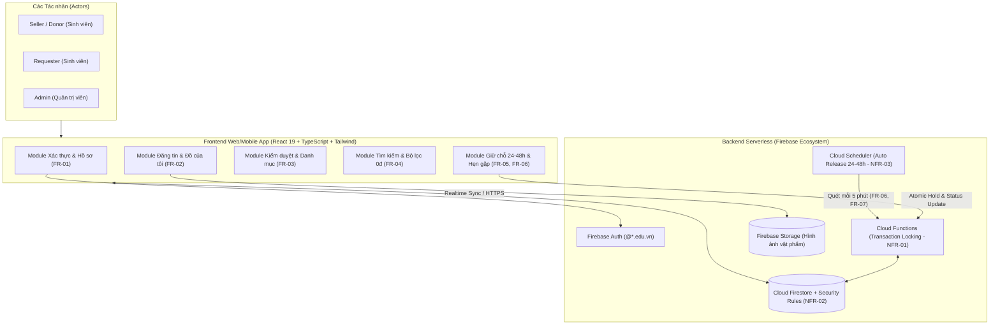
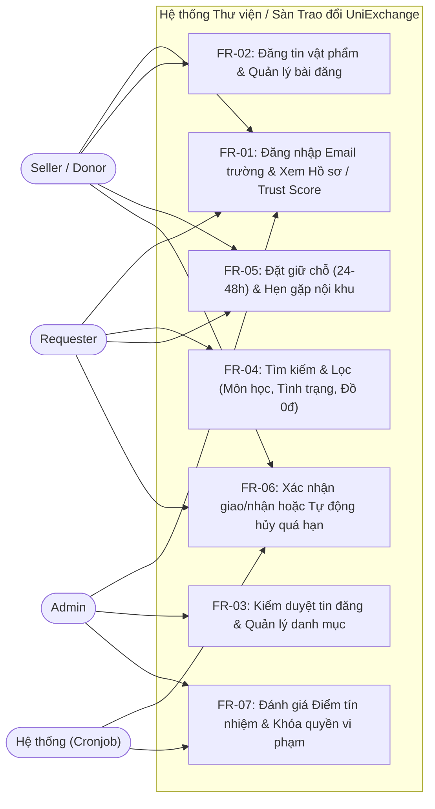
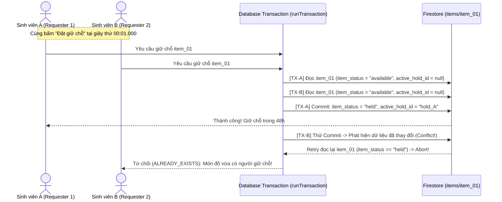

# TÀI LIỆU ĐẶC TẢ YÊU CẦU PHẦN MỀM HOÀN CHỈNH (SRS)

**Tên đề tài:** Hệ thống Thư viện / Sàn Trao đổi Giáo trình & Thiết bị Cũ trong Trường học (**UniExchange**)  
**Phiên bản:** 2.0 (Chuẩn hóa theo Tài liệu Đặc tả Sơ bộ & WBS Nhóm)  
**Tiêu chuẩn áp dụng:** IEEE Std 830-1998 / ISO/IEC/IEEE 29148:2018  
**Hạng mục bàn giao:** WBS 1.2 – 1.4 (Tài liệu SRS hoàn chỉnh & Đặc tả chi tiết Use Case)  

### Danh sách Thành viên Thực hiện & Phân công Trách nhiệm (Theo WBS)

| Ký hiệu | Họ và tên | Vai trò chính (Role) | Trách nhiệm cốt lõi trong đồ án |
| :---: | :--- | :--- | :--- |
| **TV1** | **Thành Đạt** | Project Manager (PM) & Backend Core | Quản lý tiến độ, thiết kế kiến trúc hệ thống, xử lý nghiệp vụ giữ chỗ (`Hold 24–48h`) & Khóa tài nguyên chống `Race Condition` (`FR-05`, `NFR-01`). |
| **TV2** | **Quốc Dũng** | Database Engineer (DB) & Backend | Thiết kế sơ đồ ERD, đặc tả CSDL (`NFR-02`), xây dựng module Điểm tín nhiệm (`Trust Score` - `FR-07`) và tiến trình tự động `Cronjob` (`FR-06`, `NFR-03`). |
| **TV3** | **Văn Dệ** | Business Analyst (BA) & Backend | Viết đặc tả SRS, vẽ sơ đồ UML (Use Case, Activity), xây dựng nghiệp vụ Đăng tin (`FR-02`), Kiểm duyệt Admin (`FR-03`) & Tìm kiếm/Lọc (`FR-04`). |
| **TV4** | **Tiến Thắng** | UI/UX Designer & Frontend Lead (FE) | Thiết kế giao diện Figma, lập trình giao diện Web/App cho 3 Actors, ghép nối API và phụ trách kịch bản Kiểm thử (`WBS 4.1`). |

---

## 1. Giới thiệu (Introduction)

### 1.1. Tên đề tài
**Hệ thống Thư viện / Sàn Trao đổi Giáo trình & Thiết bị Cũ trong Trường học** (Tên định danh sản phẩm: **UniExchange**).

### 1.2. Mục tiêu hệ thống (System Objectives)
1. **Giảm thiểu lãng phí tài nguyên học tập:** Giải quyết tình trạng lãng phí sách giáo trình, máy tính bỏ túi, dụng cụ thực hành và tài liệu ôn thi của sinh viên khóa trên sau khi ra trường hoặc kết thúc môn học.
2. **Tiết kiệm chi phí cho sinh viên:** Giúp sinh viên khóa dưới tiếp cận nguồn học liệu chất lượng thông qua hai hình thức: **Tặng miễn phí (`0 đồng`)** hoặc **Nhượng lại với mức giá tượng trưng**.
3. **Xây dựng môi trường trao đổi văn minh, an toàn:** Tổ chức giao nhận trực tiếp tại các điểm hẹn công khai ngay trong khuôn viên trường học, kết hợp cơ chế kiểm duyệt nội dung và đánh giá **Điểm tín nhiệm (`Trust Score`)** tự động để ngăn chặn spam, bán hàng thương mại và bùng hẹn.

### 1.3. Phạm vi hệ thống (Scope)
Ứng dụng Web/Mobile Responsive nội bộ dành riêng cho **sinh viên** và **ban quản trị** trong trường đại học, bao gồm trọn vẹn quy trình khép kín: Xác thực bằng tài khoản sinh viên → Đăng tin vật phẩm → Kiểm duyệt bài đăng → Tìm kiếm & Lọc (theo môn học, tình trạng, đồ 0 đồng) → Đặt giữ chỗ độc quyền 24–48h & Hẹn gặp nội khu → Xác nhận giao/nhận hoặc tự động mở khóa khi quá hạn → Cộng/trừ Điểm tín nhiệm.

### 1.4. Định nghĩa, Thuật ngữ và Từ viết tắt

| Thuật ngữ | Giải thích nghiệp vụ |
| :--- | :--- |
| **Seller / Donor** | *Người cho / Người bán* — Sinh viên sở hữu giáo trình, thiết bị cũ đăng bài tặng (`0đ`) hoặc bán lại giá tượng trưng. |
| **Requester** | *Người nhận / Người mua* — Sinh viên tìm kiếm, đặt giữ chỗ và hẹn gặp để nhận/mua giáo trình, thiết bị. |
| **Admin** | *Quản trị viên* — Người kiểm duyệt bài đăng, quản lý danh mục môn học/điểm hẹn và giám sát điểm tín nhiệm. |
| **Hold (Giữ chỗ)** | Cơ chế khóa tạm thời vật phẩm trong 24–48 giờ cho duy nhất 01 `Requester` để hai bên gặp mặt trao đổi. |
| **Meetup (Hẹn gặp)** | Thỏa thuận thời gian và địa điểm gặp mặt an toàn trong khuôn viên trường (Thư viện, Sảnh nhà A, Căn tin...). |
| **Trust Score** | *Điểm tín nhiệm* — Chỉ số uy tín của sinh viên (khởi tạo `100` điểm), tự động tăng/giảm dựa trên lịch sử cam kết giao dịch. |
| **No-show** | Hành vi sinh viên đặt giữ chỗ và chốt lịch hẹn nhưng không xuất hiện tại điểm hẹn và không báo hủy hợp lệ. |
| **Race Condition** | Xung đột đồng thời khi nhiều `Requester` cùng bấm "Giữ chỗ" trên 1 vật phẩm tại cùng một thời điểm (cùng 1 giây). |

### 1.5. Tài liệu tham chiếu
- Tài liệu Đặc tả Yêu cầu Phần mềm Sơ bộ (*Preliminary SRS*) & Bảng Phân rã Công việc (*WBS*).
- Đặc tả Cơ sở dữ liệu: `Dac_Ta_CSDL.docx` & Sơ đồ thực thể kết hợp: `erd_system.drawio`.
- Đặc tả Bảo mật & Phân quyền: `security_spec.md` & `firestore.rules`.

---

## 2. Tổng quan về Người dùng & Kiến trúc (Overall Description)

### 2.1. Phân loại Người dùng (User Classes and Characteristics)
Hệ thống bao gồm **03 tác nhân con người (Human Actors)** chính và **01 tác nhân hệ thống tự động**:

1. **Người cho/bán (`Seller / Donor`):**
   - Là sinh viên trong trường có nhu cầu đăng tặng (`0đ`) hoặc nhượng lại giáo trình, tài liệu, thiết bị học tập cũ.
   - Thực hiện: Đăng tin kèm ảnh & tình trạng vật phẩm, theo dõi trạng thái bài đăng, phối hợp thời gian/địa điểm hẹn gặp và xác nhận đã giao đồ.
2. **Người nhận/mua (`Requester`):**
   - Là sinh viên có nhu cầu tìm kiếm học liệu theo môn học, lọc đồ miễn phí, đặt giữ chỗ trong 24–48h và đến điểm hẹn nhận đồ.
   - **Lưu ý quan trọng:** Một tài khoản sinh viên (`role = "student"`) **có thể đóng đồng thời cả 2 vai trò `Seller/Donor` và `Requester`** trên hệ thống (nhưng không được phép tự giữ chỗ vật phẩm do chính mình đăng).
3. **Quản trị viên (`Admin`):**
   - Cán bộ quản lý thư viện / Đoàn Thanh niên / Hội Sinh viên nhà trường (`role = "admin"`).
   - Thực hiện: Kiểm duyệt duyệt/từ chối bài đăng mới chống spam/thương mại hóa, quản lý danh mục gốc (môn học, danh mục vật phẩm, điểm hẹn an toàn) và giám sát/xử lý vi phạm điểm tín nhiệm.
4. **Hệ thống tự động (`System / Scheduler`):**
   - Tác nhân nền vận hành qua Database Transaction & Cronjob định kỳ để tự động hủy giữ chỗ quá hạn (`Release Hold` sau 24–48h), tự động trừ điểm uy tín và khóa quyền nhận đồ khi điểm dưới ngưỡng tối thiểu.

### 2.2. Kiến trúc Tổng thể Hệ thống

---

## 3. Đặc tả Chi tiết Yêu cầu Chức năng (Detailed Functional Requirements)

### 3.1. Sơ đồ Use Case Tổng quát theo 3 Actors

---

### 3.2. Đặc tả từng Nhóm Yêu cầu Chức năng (`FR-01` → `FR-07`)

#### `FR-01`: Xác thực & Hồ sơ (Authentication & Profile)
- **Actor thực hiện:** `Seller`, `Requester`, `Admin`.
- **Mục tiêu:** Định danh chính xác sinh viên thuộc trường, cung cấp thông tin hồ sơ và hiển thị minh bạch Điểm tín nhiệm hiện tại.
- **Tiền điều kiện:** Người dùng truy cập ứng dụng và mở màn hình Đăng nhập.
- **Hậu điều kiện:** Phiên xác thực được khởi tạo hợp lệ; hồ sơ người dùng đồng bộ với `users/{uid}`.
- **Chi tiết yêu cầu con:**
  - **`FR-01.1` (Đăng nhập tài khoản sinh viên):** Hỗ trợ đăng nhập bằng Email nhà trường cấp (`@*.edu.vn` qua Email/Password hoặc Google Workspace trường) và xác thực bổ sung.
  - **`FR-01.2` (Khởi tạo hồ sơ sinh viên):** Lần đầu đăng nhập, hệ thống tự động tạo bản ghi người dùng gồm: Mã số sinh viên (`student_id_code`), Họ tên (`full_name`), Email, SĐT (`phone_number`), vai trò mặc định (`student`), trạng thái `active` và **Điểm tín nhiệm khởi tạo (`current_trust_score`) = `100`**.
  - **`FR-01.3` (Xem thông tin cá nhân & Điểm tín nhiệm):** Hiển thị trực quan Họ tên, Ảnh đại diện, Điểm tín nhiệm hiện tại (`current_trust_score`) ngay trên thanh điều hướng và cho phép xem lịch sử biến động điểm (`trust_history`).
  - **`FR-01.4` (Bảo vệ phân quyền):** Sinh viên chỉ được sửa thông tin cá nhân (`student_id_code`, `full_name`, `avatar_url`, `phone_number`); tuyệt đối không thể tự sửa `role` hoặc `current_trust_score`.

---

#### `FR-02`: Đăng tin vật phẩm (Post & Manage Items)
- **Actor thực hiện:** `Seller / Donor`.
- **Mục tiêu:** Cho phép sinh viên đăng tặng hoặc nhượng lại sách giáo trình, thiết bị học tập cũ kèm đầy đủ thông tin học phần và tình trạng thực tế.
- **Tiền điều kiện:** Người dùng đã đăng nhập hợp lệ và tài khoản không bị đình chỉ (`status == "active"`).
- **Hậu điều kiện:** Hình ảnh được tải lên Cloud Storage; bản ghi vật phẩm mới được tạo với trạng thái kiểm duyệt `pending` chờ Admin duyệt trước khi hiển thị công khai.
- **Chi tiết yêu cầu con:**
  - **`FR-02.1` (Nhập thông tin & Phân loại môn học):** Bắt buộc nhập Tiêu đề (`<= 100` ký tự), chọn Danh mục (`category_id`: `giao-trinh`, `thiet-bi`, `tai-lieu`, `khac`), chọn/gắn Mã môn học (`subject_id`) theo chương trình đào tạo.
  - **`FR-02.2` (Hình ảnh & Tình trạng thực tế):** Tải lên ảnh thực tế (`PNG`/`JPG`/`JPEG`), chọn mức độ mới (`condition_level`: `new_99`, `used_good`, `used_acceptable`) và nhập mô tả chi tiết (`<= 1000` ký tự).
  - **`FR-02.3` (Hình thức Tặng 0đ hoặc Giá tượng trưng):** Cho phép chọn Tặng miễn phí (`item_type = "gift"`, `price = 0 VND`) hoặc Nhượng lại với giá tượng trưng (`item_type = "sell"`, `price > 0`).
  - **`FR-02.4` (Quản lý bài đăng cá nhân):** Xem danh sách `Đồ của tôi` theo các trạng thái (`Chờ duyệt`, `Sẵn sàng trên sàn`, `Đang được giữ chỗ`, `Đã trao đổi xong`, `Bị từ chối`); cho phép chỉnh sửa hoặc xóa tin khi vật phẩm **chưa bị đặt giữ chỗ** (`item_status != "held"`).

---

#### `FR-03`: Kiểm duyệt tin đăng & Quản trị danh mục (Moderation & Master Data)
- **Actor thực hiện:** `Admin`.
- **Mục tiêu:** Đảm bảo mọi bài đăng tuân thủ nội quy học đường, ngăn chặn tin rác (spam), vật phẩm cấm hoặc buôn bán thương mại trá hình.
- **Tiền điều kiện:** Người dùng đăng nhập với tài khoản có quyền `role == "admin"`.
- **Hậu điều kiện:** Bài đăng hợp lệ chuyển sang `moderation_status = "approved"` để hiển thị lên Sàn trao đổi; mọi quyết định kiểm duyệt đều được ghi vết vào `moderation_logs`.
- **Chi tiết yêu cầu con:**
  - **`FR-03.1` (Duyệt bài đăng - Approve):** Admin xem danh sách bài đăng chờ duyệt (`pending`), kiểm tra hình ảnh/mức giá/nội dung và nhấn **Duyệt** để xuất bản lên sàn (`item_status = "available"`).
  - **`FR-03.2` (Từ chối / Ẩn bài đăng - Reject/Hide):** Admin từ chối bài đăng vi phạm kèm **Lý do từ chối** bắt buộc (VD: *Giá bán cao hơn giá bìa*, *Không phải đồ dùng học tập*, *Ảnh mờ/spam*) để `Seller` biết và chỉnh sửa.
  - **`FR-03.3` (Quản lý danh mục hệ thống):** Admin thêm mới, cập nhật hoặc vô hiệu hóa danh sách **Môn học (`subjects`)**, **Danh mục vật phẩm (`categories`)** và **Điểm hẹn an toàn trong trường (`meetup_locations`)**.

---

#### `FR-04`: Tìm kiếm & Lọc vật phẩm (Search & Filter)
- **Actor thực hiện:** `Requester` (và mọi sinh viên xem sàn).
- **Mục tiêu:** Giúp sinh viên khóa dưới nhanh chóng tìm đúng cuốn giáo trình hoặc thiết bị cần thiết theo môn học và ngân sách.
- **Tiền điều kiện:** Chỉ hiển thị các vật phẩm đã được duyệt (`moderation_status == "approved"`) và đang sẵn sàng (`item_status == "available"`).
- **Chi tiết yêu cầu con:**
  - **`FR-04.1` (Tìm kiếm từ khóa):** Tìm kiếm tức thời không phân biệt hoa thường theo **Tên giáo trình/thiết bị** hoặc **Tên/Mã môn học** (VD: `INT1340`, `Giải tích 1`).
  - **`FR-04.2` (Lọc theo Danh mục & Tình trạng):** Bộ lọc kết hợp theo loại vật phẩm (`category_id`) và mức độ mới (`condition_level`).
  - **`FR-04.3` (Lọc nhanh Đồ miễn phí 0 đồng):** Cung cấp bộ lọc chuyên biệt **"Tặng miễn phí (0 đồng)"** giúp sinh viên lọc ngay toàn bộ học liệu được khóa trên trao tặng (`item_type == "gift"` / `price == 0`).
  - **`FR-04.4` (Đồng bộ hiển thị Realtime):** Ngay khi một món đồ được người khác bấm giữ chỗ thành công, món đồ đó lập tức ẩn khỏi danh sách tìm kiếm hoặc đổi nhãn trạng thái theo thời gian thực.

---

#### `FR-05`: Giữ chỗ & Hẹn gặp (Hold & Meetup)
- **Actor thực hiện:** `Requester`, `Seller`.
- **Mục tiêu:** Đặt khóa độc quyền món đồ trong 24–48 giờ và thống nhất thời gian, địa điểm giao nhận an toàn ngay trong khuôn viên trường.
- **Tiền điều kiện:**
  1. `Requester` đã đăng nhập, `status == "active"` và có Điểm tín nhiệm đạt mức tối thiểu (`current_trust_score >= 50`).
  2. `Requester` không phải là chủ bài đăng (`requester_id != seller_id`).
  3. Vật phẩm đã duyệt (`moderation_status == "approved"`) và đang ở trạng thái `item_status == "available"` (`active_hold_id == null`).
- **Hậu điều kiện:** Vật phẩm chuyển sang trạng thái `item_status = "held"`, bản ghi `holds/{holdId}` và lịch hẹn `meetups/{meetupId}` được khởi tạo thành công với hạn `hold_expires_at` sau 24–48 giờ.
- **Chi tiết yêu cầu con:**
  - **`FR-05.1` (Đặt giữ chỗ 24–48h chống tranh chấp):** Khi `Requester` bấm **Đặt giữ chỗ**, hệ thống thực thi trong một **Database Transaction** (xem `NFR-01`) để khóa vật phẩm trong `24–48 giờ` và gán `active_hold_id`.
  - **`FR-05.2` (Chọn Địa điểm & Thời gian hẹn gặp nội khu):** `Requester` chọn một địa điểm an toàn trong khuôn viên trường (`meetup_locations`), đề xuất **Thời gian hẹn gặp cụ thể (`proposed_time`)** nằm trong khung 24–48h giữ chỗ và ghi chú nhận diện (`note`).
  - **`FR-05.3` (Phối hợp lịch hẹn giữa hai bên):** Cả `Requester` và `Seller` đều nhìn thấy thông tin lịch hẹn, thông tin liên lạc đối phương và đồng hồ đếm ngược thời hạn giữ chỗ trong mục `Lịch hẹn & Giao dịch`.

---

#### `FR-06`: Quản lý trạng thái giao dịch (Transaction Lifecycle & Auto-Release)
- **Actor thực hiện:** `Seller`, `Requester`, `Hệ thống (Scheduler)`.
- **Mục tiêu:** Đảm bảo mọi phiên giữ chỗ đều đi đến kết thúc rõ ràng: hoặc chuyển giao thành công, hoặc mở khóa kịp thời để sinh viên khác nhận.
- **Chi tiết yêu cầu con:**
  - **`FR-06.1` (Xác nhận đã giao/nhận đồ thành công):** Sau khi gặp mặt tại điểm hẹn, hai bên xác nhận hoàn tất giao dịch. Hệ thống cập nhật nguyên tử: `hold_status = "converted"`, `item_status = "completed"`, `active_hold_id = null` và ghi nhận biên bản giao dịch (`transactions` + `status_logs`).
  - **`FR-06.2` (Chủ động hủy giữ chỗ):** Cho phép `Requester` hoặc `Seller` hủy hẹn kèm lý do (`cancel_reason`). Hệ thống đổi `hold_status = "cancelled"` và lập tức trả `item_status = "available"` lên lại sàn trao đổi.
  - **`FR-06.3` (Tự động hủy giữ chỗ quá hạn - Auto Release Hold):** Nếu quá thời hạn `24–48 giờ` (`hold_expires_at <= now`) mà giao dịch chưa hoàn tất, tiến trình ngầm của Hệ thống tự động chuyển `hold_status = "expired"`, xóa khóa `active_hold_id` và khôi phục `item_status = "available"`.

---

#### `FR-07`: Đánh giá tín nhiệm (Trust Score System)
- **Actor thực hiện:** `Hệ thống`, `Admin`.
- **Mục tiêu:** Khuyến khích văn hóa đúng hẹn, ngăn chặn hành vi "giữ chỗ ảo / gom sách miễn phí rồi bỏ hẹn" làm mất cơ hội của sinh viên khác.
- **Chi tiết quy tắc tính điểm & chế tài (`BR-TRUST`):**

| Sự kiện nghiệp vụ | Mã sự kiện | Điểm biến động | Cơ chế xử lý của Hệ thống |
| :--- | :---: | :---: | :--- |
| Khởi tạo tài khoản sinh viên mới | `INIT` | **`100` (Mặc định)** | Cấp đầy đủ quyền đăng bài và đặt giữ chỗ. |
| Giao dịch trao đổi hoàn tất thành công | `COMPLETE_TX` | **`+5`** | Cộng điểm uy tín (tối đa chuẩn hiển thị 100 hoặc tích lũy), ghi vào `trust_history`. |
| Quá hạn giữ chỗ 48h không giao dịch / Hủy hẹn nhiều lần hoặc sát giờ | `CANCEL_HOLD` / `EXPIRED_HOLD` | **`-10`** | Tự động trừ điểm ngay khi hủy sát giờ hoặc khi Cronjob quét quá hạn 48h. |
| Không đến điểm hẹn mà không báo hủy (*No-show*) | `NO_SHOW` | **`-30`** | Trừ nặng điểm uy tín khi xác nhận báo cáo bùng hẹn từ đối phương / Admin. |
| Admin điều chỉnh khi giải quyết khiếu nại | `ADMIN_ADJUST` | **Tùy chỉnh** | Admin khôi phục hoặc trừ điểm kèm lý do minh bạch trong sổ cái `trust_history`. |
| **Điểm tín nhiệm dưới mức tối thiểu (`< 50`)** | `LOCK_HOLD` | **Khóa quyền nhận** | **Tự động khóa/hạn chế quyền bấm "Đặt giữ chỗ"** đối với tài khoản vi phạm. |

---

## 4. Yêu cầu Phi chức năng Trọng tâm (Core Non-Functional Requirements)

### 4.1. `NFR-01` — Xử lý đồng thời & Chống tranh chấp (Concurrency & Race Condition)
- **Bài toán nghiệp vụ:** Vào đầu học kỳ, một cuốn giáo trình tặng `0 đồng` có thể được hàng chục sinh viên mở xem và có >= 2 sinh viên cùng bấm nút **"Đặt giữ đồ"** tại cùng một giây (`t0`).
- **Yêu cầu kỹ thuật bắt buộc:**
  1. Tuyệt đối **không xử lý tách rời** hai lệnh kiểm tra và cập nhật ở phía Client.
  2. Phải sử dụng **Giao dịch cơ sở dữ liệu nguyên tử (`Firestore runTransaction`)** kết hợp cơ chế khóa lạc quan (*Optimistic Concurrency Control* / cờ khóa `active_hold_id`):
     - Trong cùng một Transaction: Đọc trạng thái `items/{itemId}` → Kiểm tra `item_status == "available" && active_hold_id == null` → Ghi `holds/{newHoldId}` → Cập nhật `items/{itemId}.item_status = "held"` và `active_hold_id = newHoldId`.
     - Nếu 2 request đến cùng 1 mili-giây, Firestore tự động tuần tự hóa hoặc thử lại dựa trên phiên bản dữ liệu; chỉ **duy nhất 01 request đầu tiên thành công**, request còn lại nhận thông báo *"Món đồ vừa được sinh viên khác giữ chỗ!"*.
- **Tiêu chí nghiệm thu (WBS 4.2):** Thực hiện kịch bản bắn đồng thời >= 2 request giữ chỗ trong cùng 1 giây vào cùng 1 `itemId`; kết quả CSDL chỉ sinh ra đúng **01** bản ghi `Hold` ở trạng thái `active`.

### 4.2. `NFR-02` — Toàn vẹn dữ liệu & Bảo mật (Data Integrity & Security)
- **Ràng buộc trạng thái vật phẩm (`State Invariant`):**
  - Vật phẩm chỉ được chuyển `available -> held` khi gắn kèm một `Hold` hợp lệ đang `active`.
  - Vật phẩm đang `held` không thể bị chủ bài đăng xóa ngang (`BR-01`) và không thể tạo chồng thêm `Hold` thứ hai.
  - Vật phẩm chỉ chuyển sang `completed` khi `Hold` tương ứng chuyển sang `converted`.
- **Sổ cái Điểm tín nhiệm bất biến (`Append-only Ledger`):**
  - Mọi lần cộng/trừ `current_trust_score` của sinh viên đều phải đi kèm một bản ghi lịch sử trong `users/{uid}/trust_history` ghi rõ `score_change`, `balance_after`, `event_type`, `reference_id` và `created_at` để đảm bảo tính minh bạch, đối soát được 100%.
- **Bảo mật phân quyền (`Firestore Security Rules`):**
  - Chặn toàn bộ hành vi giả mạo danh tính (`Identity Spoofing`), tự nâng quyền (`Role Escalation`), tự sửa điểm uy tín, đặt giá âm (`Price Poisoning`) và tự giữ đồ của chính mình (`Self-Reservation`).

### 4.3. `NFR-03` — Tự động hóa bằng Tiến trình ngầm (Background Jobs / Cronjob)
- **Cơ chế vận hành:** Sử dụng bộ lập lịch tự động (`Cloud Scheduler` + `Cloud Functions`) chạy định kỳ **mỗi 5 phút/lần** mà không phụ thuộc vào việc người dùng có mở ứng dụng hay không.
- **Nhiệm vụ xử lý theo lô (`Batch Processing`):**
  1. Truy vấn các bản ghi `holds` có `hold_status == "active"` và `hold_expires_at <= now()` (nhờ Composite Index `[hold_status ASC, hold_expires_at ASC]`).
  2. Trong một Transaction nguyên tử: Đổi trạng thái `Hold -> expired`, mở khóa `Item -> available` (`active_hold_id = null`), đồng thời trừ điểm uy tín (`-10`) và ghi nhận lịch sử vào `trust_history`.
- **Hiệu năng & Độ trễ mở khóa:** Độ trễ tối đa kể từ thời điểm hết hạn 48h đến khi sách quay trở lại Sàn trao đổi không vượt quá **5 phút**.

### 4.4. Yêu cầu Phi chức năng Bổ trợ (UI/UX & Hiệu năng)
- **Hiệu năng thời gian thực:** Tải danh sách sàn trao đổi dưới **1.5 giây**, phản hồi đồng bộ trạng thái Realtime dưới **500 ms**.
- **Tương thích thiết bị:** Thiết kế Mobile-first Responsive thuận tiện cho sinh viên mở điện thoại xem lịch hẹn và đối chiếu khi gặp nhau tại sân trường / thư viện.

---

## 5. Ma trận Truy vết Yêu cầu theo WBS & Kiến trúc Dữ liệu

| Mã YC | Nhóm chức năng | Hạng mục WBS liên quan | Phụ trách (PIC) | Thực thể CSDL liên quan (`NFR-02`) |
| :---: | :--- | :---: | :---: | :--- |
| **FR-01** | Xác thực & Hồ sơ | `WBS 3.2` | TV3, TV4 | `users` |
| **FR-02** | Đăng tin vật phẩm | `WBS 3.3` | TV3, TV4 | `items`, `categories`, `subjects`, Storage |
| **FR-03** | Kiểm duyệt tin đăng & Danh mục | `WBS 3.2`, `WBS 3.3` | TV3, TV4 | `items`, `moderation_logs`, `subjects`, `meetup_locations` |
| **FR-04** | Tìm kiếm & Lọc (kể cả lọc 0đ) | `WBS 3.3` | TV3, TV4 | `items` (Composite Indexes) |
| **FR-05** | Giữ chỗ (24–48h) & Hẹn gặp | `WBS 2.3`, `WBS 3.4` | TV1, TV4 | `holds`, `meetups`, `meetup_locations`, `items` |
| **FR-06** | Quản lý trạng thái giao dịch | `WBS 3.4`, `WBS 3.5` | TV1, TV2, TV4 | `holds`, `items`, `transactions`, `status_logs` |
| **FR-07** | Đánh giá tín nhiệm (`Trust Score`) | `WBS 3.5` | TV2 | `users`, `trust_history` |
| **NFR-01** | Chống `Race Condition` | `WBS 3.4`, `WBS 4.2` | TV1, TV2 | `items` + `holds` (`runTransaction`) |
| **NFR-02** | Toàn vẹn dữ liệu (ERD & Rules) | `WBS 2.2` | TV2 | Toàn bộ Schema & `firestore.rules` |
| **NFR-03** | Tiến trình ngầm (`Cronjob`) | `WBS 3.5` | TV2 | `holds`, `items`, `users`, `trust_history` |
